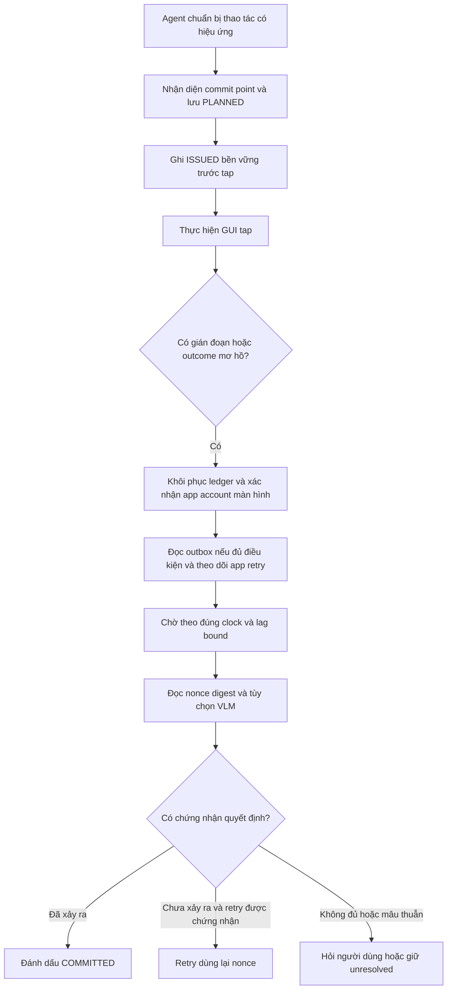

# GhostEffect: kiểm tra nội dung, dữ liệu, code và kế hoạch thí nghiệm

## Trạng thái mới nhất v10 — native AVD đã có smoke, pipeline chưa hoàn tất

**Chưa resolve hết các runtime gates. Không cần điện thoại Android vật lý cho core của plan hiện tại.** SDK/API33r17/AVD/WHPX local đã chạy thực; native AndroidWorld lấy được screenshot2400×1080×3 và accessibility forest. [Native observation receipt](tmp/resolve-v10/native-smoke-01/native-env/RESULT.json). Điện thoại vật lý chỉ cần nếu mở scope OEM/pin/năng lượng/mất nguồn phần cứng; các claim đó ngoài core. Paper được giữ nguyên, lượt này chỉ code/setup/plan/report và evidence riêng.

**Đã sửa và kiểm thêm:** pin/tải forwarder APK vào `runtime/assets`, signature/manifest verification11APKs gồm instrumentation; cài và kiểm installedSHA trước native smoke. Kết nối adb5038/gRPC8554 dùng env con tối thiểu, không truyền backend/model-provider credentials. Capture lưu raw window/input dumps khi guard fail. Native setup reset về Home rồi launch app và ẩn pointer UI như trình tự upstream; trước đó khởi động forwarder trên màn hình tĩnh có thể cho empty forest. Không biến bootstrap/warmup thành calibration observations.

[Native wiring fixture](tmp/resolve-v10/native-wire-host-02/RESULT.json) PASS cho M3A/T3A: mỗi framework thực thi một BACK qua native adb và một reflection, giữ native history1entry. M3A có2ảnh/request, T3A0ảnh/request, full1080×2400. **Responses là cố định từ loopback test server; không LLM inference, không task success hoặc baseline quality.** Không cộng vào A-dev/A-native/B0/calibration/878–1090. [M3A receipt](tmp/resolve-v10/native-wire-host-02/native-env/scripted-wire-m3a/RESULT.json), [T3A receipt](tmp/resolve-v10/native-wire-host-02/native-env/scripted-wire-t3a/RESULT.json), [field đếm cũ](tmp/resolve-v10/RECEIPT-QUALIFICATIONS.json). Màn hình vẫn là Markor onboarding, không P37 fixture đã hoàn tất.

Các lượt lỗi giữ nguyên: wire01 fail ở UI-Automator focus guard; wire02 raw dumps xác nhận SystemUI ANR; host-renderer01 có RGB nhưng forest rỗng. Lượt host02 thêm đúng reset/launch/hide sequence và qua smoke. Đây chưa là bằng chứng ANR hết hoặc renderer tối ưu: thay renderer/timing cùng lúc nên không tách được hiệu ứng, chưa freeze graphics cho study. Tất cả AVD do smoke sở hữu đã tắt; không tự dismiss ANR hoặc rerun scientific failure để lấy PASS.

**Kiểm thử hiện tại:**67test cases/môi trường; Windows thực chạy63/skip4, Linux64/skip3, agentenv66/skip1, đều PASS. [Windows](tmp/resolve-v10/tests-windows.json), [Linux](tmp/resolve-v10/tests-linux.json), [agentenv](tmp/resolve-v10/tests-agent-env.json), [validation](tmp/resolve-v10/VALIDATION.json). Vẫn thiếu: model-driven episode harness/full actions, frameworkA3–A5, account/task/reset/graderP40, injector và semantic fate/clock/probe joins, calibration thật và actual H100 serving/fit/load. F3/F4 còn phải kiểm native forwarder tự khôi phục networking và chứng minh blackout đúng app/backend path, giữ observation/control plane. Chưa model weights/inference/campaign hoặc kết luận H1–H4.

## Quy ước đã chốt v9 — kết quả chạy mới là nguồn chuẩn

**Chỉ thị mới nhất: không chỉnh paper; paper để sau.** Đã khôi phục toàn bộ21file generatedTeX/PDF bị lượt numerical refresh vừa rồi thay đổi, kiểm hash khớp bản trước lượt này. [Receipt khôi phục](tmp/resolve-v9/draft-refresh/PAPER-RESTORED.json). Chỉ giữ code, plan/report và kết quả thí nghiệm; không tiếp tục ghi vào `manuscript/`, kể cả generated files hoặc PDF.

Người dùng xác nhận mọi số kết quả trong draft chỉ để minh họa, không phải core cần giữ. **Không cần tái tạo47.35% hoặc điều tra thêm để khớp số archive.** Core để đối chiếu là phương pháp/pipeline và thiết kế thí nghiệm; hypotheses là điều cần kiểm định, không phải outcomes được lập trình để đạt. Các ghi chú “conflict ASK còn mở” ở lịch sử v6–v8 bên dưới đã được quyết định này thay thế, không còn việc cần người dùng xác minh hoặc blocker của plan.

Số dùng báo cáo thí nghiệm lấy từ run có source/config/command/raw/exit/hash. Simulation, fixture, host/protocol smoke, Android agent và calibration đo thật được ghi riêng; chưa chạy loại nào thì không có kết quả loại đó. Kết quả mới lưu riêng để dùng khi đến giai đoạn sửa paper, không cập nhật manuscript trong lượt này. Những việc còn thiếu thực sự là Android/task/reset/grader, official agent wiring, fate/clock collector, calibration và H100 runtime evidence.

**Kết quả simulation mới:** main chạy5×2400workflows/cell; source-family ASK=47.008333%. CSV mới được giữ trong artifact/results và isolated run. Mình đã hiểu sai phạm vi và publish generatedTeX/PDF, sau đó **khôi phục đầy đủ theo yêu cầu không chỉnh paper**; các publication receipts chỉ còn là lịch sử thao tác, không mô tả paper hiện tại. [Run/command/CSV provenance](tmp/resolve-v9/draft-refresh/PUBLICATION.json), [khôi phục paper](tmp/resolve-v9/draft-refresh/PAPER-RESTORED.json). Đây là simulation và host/archived-input outputs theo từng nguồn, **không có agent hoặc calibration measurement mới**; các nhánh dùng archive không được nâng thành measured evidence mới.

**Setup/code mới:** `androidworld_env.py` nối native AndroidWorld với adb server/serial/gRPC explicit, kể cả reconnect; factory trả native M3A/T3A, giữ defaults/history và text-only củaT3A. Actual pinned-source binding tests đã qua; chưa chạy environment/gRPC với AVD hoặc model episode. `ui.py` lưu raw tree/dump/error stage khi capture lỗi, không sửa XML hoặc tự retry. SimpleSMS startup mới đã mở MainActivity và capture được với input guard, nhưng hai cây khác bounds nên `stable_tree=false`: chỉ PASS boot/install/launch/capture, **chưa qualify reader/task**. [Smoke receipt](tmp/resolve-v9/sms-startup-diagnostics/RESULT.json). Helper setup SMS nay chọn radio, confirm và đóng dialog đã-default theo state GUI; branch tests có, chưa kiểm lại toàn bộ sequence helper trên clean role state.

**Kiểm thử mới nhất v9:** 66test cases/môi trường; WindowsPython3.12 qua62/skip4, Linux qua63/skip3, agentPython3.11 qua65/skip1. Ba native tests thực chạy trong agentenv, không chỉ skip rồi gọi PASS. [Windows](tmp/resolve-v9/tests-windows.json), [Linux](tmp/resolve-v9/tests-linux.json), [agentenv](tmp/resolve-v9/tests-agent-env.json), [validation](tmp/resolve-v9/VALIDATION.json). Scope vẫn là component/native-source wiring; chưa phải end-to-end paper pipeline.

Numerical artifact regression chạy lại32cases PASS/1skip;49CSV qua schema/count checks. [Integrity](tmp/resolve-v9/INTEGRITY.json) kiểm derived CSV và việc paper đã được khôi phục; raw measurements, numerical source và prose giữ nguyên. [Local links](tmp/resolve-v9/LINKS.json) được kiểm, không link thiếu. Whitespace check chấp nhận CRLF chuẩn của CSV; không đổi bytes output chỉ để làm lint đẹp.

## Trạng thái mới nhất v8 — setup local, chưa chạy campaign paper

Đã thực hiện setup local theo yêu cầu trước đó: SDK/AVD, APK, backend test, source baseline và môi trường Python đều ở `runtime/`. Đây là setup và kiểm thử thành phần; **chưa tải trọng số model, chưa chạy native agent episode hoặc campaign 878/1090, chưa thu calibration thật, chưa dùng H100 hay model API trả phí**. Không có SSH server. Các mục bên dưới ghi v6/v7 là lịch sử; trạng thái mới này có ưu tiên khi đọc tiến độ.

Đã checkout đầy đủ bốn repo đúng commit trong [models](codex/models.md): AndroidWorld, AgentProg, UI-TARS và Mobile-Agent. Python3.11.8 project-local và dependency AndroidWorld đã cài; import thực M3A/T3A/env launcher thành công. [Receipt](runtime/agents/SETUP.json) ghi rõ `SOURCE_AND_IMPORTS_VERIFIED_NOT_AGENT_EXECUTION`; import thành công không có nghĩa năm framework đã chạy được. AgentProg có dependency khác AndroidWorld, còn phải kiểm tương thích trước khi nối runner; không tự đổi thuật toán để né dependency.

AVD phát hiện SystemUI ANR: cây accessibility/cửa sổ app có thể vẫn tồn tại bên dưới hộp thoại nhận input. `testbed/ui.py` nay đối chiếu token cửa sổ với InputDispatcher, chặn mismatch/frozen/khác display và xử lý CRLF của adb Windows. Đây là sửa guard đúng yêu cầu GUI/window của paper, không thêm vote, đổi model, quota hoặc hypothesis. Fixture ANR dùng các block dump thực nhưng ghép từ hai thời điểm; không gọi đó là một observation nguyên tử hoặc dữ liệu calibration.

Kiểm thử mới nhất: **60 testbed tests trên mỗi host**; Windows PASS với1 POSIX-only skip, Linux PASS không skip. [Windows receipt](tmp/resolve-v8/testbed-tests-windows.json), [Linux receipt](tmp/resolve-v8/testbed-tests-linux.json). Đây là component/fixture tests, không phải60 Android trials. [Validation v8](tmp/resolve-v8/VALIDATION.json) ghi giới hạn và trạng thái còn mở.

SimpleSMS đã được gán default role trong AVD bằng GUI, nhưng vẫn thấy dialog cũ nên [diagnostic](tmp/resolve-v8/sms-live-02/RESULT.json) là **NOT_READY**. Lần cold-start tiếp theo [FAILED](tmp/resolve-v8/sms-startup-01/RESULT.json) khi parse cây UI; lần này chưa lưu raw bytes lỗi nên chưa xác minh được nguyên nhân. Không suy diễn đây là lỗi model, không xóa failure hoặc tính vào scientific trials. AVD của lượt này đã dừng. Smoke04/05 trước đây chỉ chứng minh install/launch/capture ở thời điểm đó, không chứng minh readiness dưới guard input mới.

Phần bắt buộc tiếp theo vẫn là: ổn định capture/setup app; account/task fixtures và reset/grader P40; nối official framework environment/action vào host controller; collector nối fate/probe/clock; calibration đo thật; rồi pilot và full paired study. H100 model fit/throughput cần server evidence. Archive ASK discrepancy không còn blocker theo quyết định v9. [Chi tiết evidence, đối chiếu paper và thứ tự làm](codex/resolve-progress.md).

## Resolve tiếp theo v7 — 08/11/2026

Đang tiếp tục theo yêu cầu sửa hết các phần còn làm được, giữ core/pipeline/năm frameworks/P40/model pins/quy mô và hypotheses của draft. [Biên bản vòng19–24, code/paper mapping và việc còn phải làm](codex/resolve-progress.md). Người dùng xác nhận chưa có SSH server và yêu cầu tiếp tục local. **Chưa coi toàn mục tiêu hoàn tất.**

Đã bổ sung calibration compiler và Algorithm1 runtime (product/source/joint, clock/wait, class fallback, Monitor/ASK/PENDING), durable read-once cache qua restart, semantic history-item digest, lexicon classifier, GUIObserver và thin M3A/T3A local-vLLM binding. Windows/Linux đều qua32artifact tests; latest testbed58tests (Windows skip1 POSIX, Linux khôngskip), có actual SIGKILL giữa đọc view rồi restart không resample. Vòng23 sửa unknown-class deadlines theo từng clock, Monitor age từ ISSUED, hop1 không nonce, effect-bound status, skipVLM theo pre-tap lookalike và full activity/account/window dispatch guard. Đây là component/fixture evidence, chưa agent quality/calibration thật.

Đã tải đủ bốn historical APK đúng SHA và cài Synapse1.164.2/Radicale3.9.0 trong venv riêng ởproject. Cả hai backend thật qua4protocol cases mỗi stack (nofault, committed/lostACK cùngID, newID duplicate, preapply reject+late sameID); GreenMail đã có từv6. Không cộng protocol synthetic payloads vào trial quota. Pro Expense đã xác minh source/package/binary/signature: `com.arduia.expense`, versionCode11/1.0.0-beta05; task UI/reset/grader còn cần kiểm.

**Android local đã chạy thật:** SDK/emulator37.2.13, imageAPI33/r17 x86_64 và AVD nằm trong `runtime/`. WHPX acceleration usable; [smoke04](tmp/resolve-v7/android/smoke-04/RESULT.json) PASS boot/install/hash/launch/capture cho Element/K-9/DAVx5/Etar. Element dùng bản1.6.62 x86_64 versionCode40106624, cùng signer với bảnARM64, là replication stratum mới. Không chuyển calibration/lag lịch sử sang ABI này. Ba lượt smoke phát hiện lỗi trước đó được giữ nguyên; đã sửa focus reader tránh lấy cửa sổ cũ trong “Last ANR”, không xóa failures để báo PASS. Element onboarding carousel làm tree chưa ổn định; chưa qualify history profile.

Đã tải và kiểm chữ ký cả năm candidate APK còn lại từ pinned AndroidWorld: Pro Expense1.0.0-beta05/code11, Markor2.10.9, Tasks.org13.6.3, SimpleSMS5.19.3, Joplin3.0.1; [verification](tmp/resolve-v7/android/setup-03/RESULT.json), [lock](testbed/assets-catalogue.lock.json). Binary availability đã resolve, actual task fixtures/reset/grader và app licenses trước redistribution còn phải hoàn thiện. Chưa đủ bằng chứng gọi fullP40 ready.

[Smoke05](tmp/resolve-v7/android/smoke-05/RESULT.json): cả5candidate cài đúngSHA;4app mở đúng foreground, SimpleSMS còn ở Android default-SMS chooser. Tổng9real apps installed,8startup foreground verified. Các thử06–09 chưa xử lý được SMS role/input: CLI unsupported/help-code/timeout rồi GUI selector vẫn chưa enable confirm; giữ FAILED/NOT_READY và rawXML, không báo full startupPASS. Đây là việc local còn phải debug, không dữ liệu thí nghiệm/H4. [Tổng hợp validation mới](tmp/resolve-v7/VALIDATION-v24.json).

Conflict archived source/output vẫn mở sau kiểm phủ định: hai variant sửa floating boundary không giải thích ASK47.35% vs47.00833%. Source zip gốc khớp byte-for-byte source baseline trước sửa. Giữ evidence riêng, không đổi số/RNG để ép khớp. Tiếp theo là Android accounts/task profiles/reset, official framework environment/action wiring, collector/fate joins và measured calibration/P40/H100 readiness. Những mô tả v6 bên dưới là lịch sử trước các bổ sung này.

## Cập nhật implementation và dựng lại testbed — 08/11/2026

Người dùng xác nhận không còn source `shared-android` và cho phép dựng lại. Đã tạo [testbed/](testbed/README.md): proxy Matrix/CalDAV/SMTP có commit/ACK barrier, ADB reader và driver theo profile, backend grader riêng, host write-ahead controller, downloader có historical hashes, backend setup và smoke. Đây là **reconstruction**, chưa phải rig gốc hoặc một hệ thống năm agent đã kiểm chứng.

Đã sửa các lỗi code thực: ledger/state/restart guards; minimum sample search193 thay221 ở counterexample; asymmetric delta; denominator0→N/A và conditional ASK; safe isolated runner có REAL4; renderer có staging/rollback; build không nuốt lỗi; nonce MC tối ưu nhưng giữ exact matching/RNG; provenance K-9 không còn khẳng định20/20 explicit Send khi log chỉ có8/20. [Chi tiết thay đổi, evidence và phần còn thiếu](codex/code-fixes.md).

**Kiểm thử đã chạy:**32 artifact regression tests và19 testbed tests trên cả Windows/Linux; full numerical/artifact suite25jobs PASS trong isolated workspace, đủ16REAL4tags. Đã tải GreenMail2.1.2 vào `runtime/assets`, SHA256 khớp log gốc; smoke với backend thật PASS4protocol cases. Unit fixtures và mail smoke là dữ liệu tổng hợp, không cộng vào cohort thí nghiệm. POSIX host SIGKILL benchmark giữ300kills; không coi đó là power loss/phone measurement.

**Conflict cần giữ rõ:** archived main `ghost-src` ASK47.35%, nhưng source **trước sửa** trên Windows và Linux đều cho47.00833%, trùng run mới. Một số stress/sweep/ncal/share/class cũng lệch; không thể nói tất cả outputs byte-identical hoặc tất cả lệch là rounding. Measured-real/REAL4 point estimates khớp. Giữ archive/raw/PDF, ghi run mới riêng và cần source/environment đúng revision cũ để giải thích provenance; chưa có bằng chứng để kết luận fabrication. [Full diff](tmp/code-fixes-v6/ARCHIVE_COMPARISON.json).

**Chưa chạy Android/LLM/H4:** chưa ADB/APK/AVD, WSL không `/dev/kvm`; app profiles chưa kiểm trên màn hình thật, Synapse/Radicale chưa cài, official framework bindings/real calibration/certified cascade/qualified Monitor còn thiếu. Controller hiện ASK khi thiếu certificate; điều này không đóng H4. Quy mô878/1090, P40/năm frameworks và ba model pins giữ nguyên. Thứ tự tiếp: actual stack/profiles/reset → M3A native pilot → calibrated protected integration → full paired paper study; không mở thêm campaign hoặc thay pipeline.

Các mục review-only phía dưới là lịch sử trước bước sửa code này. Không viết lại manuscript; kết quả mới nằm trong `tmp/code-fixes-v6/` và source dựng lại trong `testbed/`.

## Cập nhật review và plan — 08/11/2026, h100-plan-v6

Đã làm thêm **bốn vòng review13–16**: đọc lại draft PDF trang11/18, kiểm quy mô/calibration, kiểm hiệu năng/overengineering, rồi đọc chéo tài liệu revise. Đây là audit kế hoạch inline, không reviewer độc lập, chưa chạy agent/model/Android campaign. [Biên bản đầy đủ](codex/review-loop.md#vòng-13--đối-chiếu-lại-draft-pdf), [plan active](codex/plan.md), [đối chiếu paper](codex/paper-alignment.md).

**Đánh giá quy mô:** giữ878 scheduled milestone và1090 có protected/sentinel; trong đó C có600episodes=5frameworks×40tasks×3arms. Quy mô này hợp lý cho benchmark và failure mechanisms, chưa đủ để xác nhận empirical risk1% riêng từng app/agent. Calibration và fixture-development chưa nằm trong tổng; không tự tăng repeats/full factorial hoặc nhân11000mẫu cho mọi domain.

Những sửa đổi có tác dụng thực tế:

1. A/B mail giữ GreenMail như dữ liệu lịch sử; P17–P20 final chọn Postfix+localIMAP như app table của draft, với pins/calibration riêng chưa thu.
2. Làm rõ AgentProg workflow/executor/V1 share Qwen engine, UI-TARS là locator engine: tối đa2engines, không3; giữ role isolation/model/history/input recipe.
3. E09 tính actual K_total/n/cost trước acquisition;5000holdout không mặc định đủ. Đổi flag recipe thành RUN_CERT1_EXTRA_COLLECTION để không hiểu OFF là bỏ calibration của protected study.
4. Bỏ nhánh8AVD khỏi core; giữ1/2/4 với80dev effects và model dev fixtures hiện có. Không giảm precision/input hoặc thay pipeline để vừa máy.
5. H3 cần eligible WorkManager outbox/G2 và F2force-stop receipts; chưa có subgroup đã xác minh thì NOT_TESTED. Classifier/reader phải freeze trước B0eval240, heldout không tuning.
6. Rà thêm các conflict kỹ thuật: trả lag share về test share cho local-only apps theo design; P-final nonce body khác subject của A/B; không đọc optimistic Outbox như committed nonce; idle entry/exit phải được ghi trước GUI wake/relaunch. R23 đã bỏ điều kiện sai rằng calibration chỉ cần khi bật CERT-1. Không tăng quota hoặc đổi pipeline.

Chưa resolve bằng evidence: Pro Expense identity, original rig/raw missing, APK/backend pins và reset/grader mới, H3 eligibility, actual H100/KVM/fit/throughput, calibration acquisition budget. Các lỗi code E01/E02/E09 vẫn là implementation work; review plan không đóng chúng. Checkout hiện tại không có collab bundle để kiểm lại notebooks. [Checklist active](codex/checklist.md#8-v6-fixes-và-remaining-readiness).

Các quy mô/cấu hình trong audit gốc phía dưới là lịch sử; nếu khác, ưu tiên v6 trong codex/plan.md, study-matrix.md và models.md. Manuscript/code/raw giữ nguyên trong lượt review này.

Đã đối chiếu đủ10mục bắt buộc của meta-review với resolution/procedure/evidence cần tạo; bảng nghiệm thu nằm ở [review-loop](codex/review-loop.md#nghiệm-thu-nội-dung-theo-yêu-cầu-reviewer-và-người-dùng). Hoàn thành phần review/revise plan; các thí nghiệm, code fixes, proof-domain checks và collection còn mở đúng trạng thái, chưa claim empirical resolution.

Ngày kiểm tra: **07/11/2026**, giờ Việt Nam. Phạm vi: toàn bộ tài liệu và artifact hiện có trong `P03-ghosteffect`. Báo cáo này phục vụ **làm thí nghiệm**, chưa viết lại paper.

## Material Passport — phạm vi và mức kiểm chứng

**Verification Status: ANALYZED.** Đã đọc tài liệu, đối chiếu source/code/CSV/log, kiểm tra cú pháp 13 file Python và thực hiện một số phép tính, kiểm tra ledger trong bộ nhớ. **Chưa chạy lại pipeline thí nghiệm đầy đủ, chưa tái tạo emulator campaign, chưa chạy agent hay điện thoại thật.** Các tỷ lệ bên dưới là số trong artifact hiện có, trừ nơi ghi rõ là phép tính của đợt kiểm tra hoặc quy mô đề xuất.

Đầu vào gồm `STATUS.md`, `review.md`, `README.md`, `others/notes.md`, toàn bộ các section và phụ lục LaTeX, các bảng/macro sinh tự động, PDF 20 trang, 13 script Python, shell scripts, PRISM model, CSV và log emulator. Đã đối chiếu nội dung PDF với source ở các phần chính; không làm một đợt sửa hoặc kiểm tra dàn trang toàn bộ PDF. Không khẳng định đã xác minh độc lập toàn bộ 123 tài liệu tham khảo: file citation audit mà tài liệu dẫn tới không có trong checkout.

Ba subagent kiểm tra độc lập: **dữ liệu đo và nguồn bằng chứng**, **code và khả năng chạy**, **giả định lý thuyết và thiết kế thí nghiệm**. Các bên đã gửi phản biện chéo; các điểm đã được giải quyết trong code hoặc bị review diễn giải quá mức được tách riêng ở mục 7.

## 1. Kết luận để quyết định công việc

**Dự án có một lõi đo đạc emulator hữu ích và một simulator khá đầy đủ, nhưng chưa có hệ thống GhostEffect end-to-end đã được kiểm chứng với agent thật.** Việc cần làm tiếp theo không phải chạy ngay một campaign khổng lồ 5.000 nhãn/class. Cần khóa định nghĩa, khôi phục testbed, sửa các điểm code có thể làm sai recovery, rồi chạy pilot có đối chứng và dữ liệu giữ lại để đánh giá độc lập.

Năm vấn đề ảnh hưởng trực tiếp đến giá trị của kết quả:

1. **Clock không thống nhất:** paper chờ từ `ISSUED`/tap; lag đo chủ yếu từ relaunch hoặc network restore. Artifact đã có mô phỏng cho thấy áp dụng clock sai có thể đưa xác suất retry committed lên khoảng **18,8–46,4%**.
2. **Ngân sách dữ liệu không bằng số nhãn được quảng bá:** headline joint hỏi **12,7%** dùng 5.000 nhãn sinh/class/outcome và **20.000 lag samples/class**. Khi đặt lag bằng 5.000, tỷ lệ hỏi là **30,6%**; ở 2.000 là **100%**. Các mẫu này vẫn được sinh từ tập đo nhỏ.
3. **Chưa có kiểm chứng thực nghiệm cho cả hai phía duplicate/loss:** 101 trial Element campaign 2 đều kết thúc bằng một server copy. Không có tập `X=0` cuối cùng thực sự absent để hiệu chuẩn/đánh giá phía loss trên app này.
4. **Baseline cần được dùng công bằng:** code đã có rules được vetted bằng fault-injected labels. Trên K-9, baseline đó cũng hỏi 100%, thay vì mắc lỗi như rules chưa được vetted. Chưa chứng minh được lợi ích riêng của joint so với phương án đơn giản trên app đã đo.
5. **Hệ thống và công cụ chưa được đóng gói đủ:** thiếu source testbed `shared-android`, controller gắn agent, classifier, probe runtime và foreground service. Ledger hiện là component minh họa có các lỗ hổng state machine; không thể coi là một recovery runtime hoàn chỉnh.

**Không có cơ sở kết luận dữ liệu bị làm giả.** Có bằng chứng nhất quán giữa log protocol và CSV. Tuy nhiên, “internally consistent”, “đo được trong emulator” và “đã xác minh nguồn gốc/thành công trên điện thoại thật” là ba mức khác nhau. Mô phỏng, bootstrap, giả định lag và can thiệp timestamp phải được trình bày đúng loại bằng chứng.

## 2. Nội dung nghiên cứu và nguyên lý vận hành

### 2.1. Bài toán

Agent bấm Send/Save, server có thể đã thực hiện hiệu ứng nhưng confirmation bị mất. Sau khi agent/app/network bị gián đoạn, GUI có thể trông như chưa làm. Agent làm lại sẽ tạo một yêu cầu mới, sinh hai email, hai tin nhắn hoặc hai sự kiện. GhostEffect gọi đó là **ghost effect**.

Điểm cần phân biệt là **app tự retransmit cùng request id** và **agent thao tác GUI để tạo request mới**. Cái trước có thể được server deduplicate; cái sau thường có id mới. Nonce chỉ giúp nhận diện hiệu ứng, **không tự biến GUI redo thành idempotent**.

### 2.2. Chuỗi hoạt động dự kiến

Các thành phần và giới hạn:

| Thành phần | Vai trò | Điều kiện quan trọng |
|---|---|---|
| Ledger ngoài agent | Lưu ý định trước tap, sống qua agent crash | Phải chặn tap nếu ghi thất bại; không mất hoặc reset record khi replay |
| Classifier | Nhận diện Send/Pay/Save là commit point | Bỏ sót làm effect đi vòng qua bảo vệ; chưa có số recall |
| Nonce | Gắn tag vào nội dung, dùng lại trên retry | Field phải hiện lại đúng ngữ cảnh; cần chốt opt-in cho nội dung người nhận thấy |
| Hop 1 | Quan sát local outbox/sent entry | Chỉ được coi lag-free nếu không phụ thuộc timeline từ server; Element không đạt điều kiện này |
| Hop 2 và G2 | App retry cùng id, server dedup trong phạm vi/horizon | Không suy từ vài lần thành công thành bảo đảm cho mọi version, device, fault |
| Certified wait | Tránh kết luận absent quá sớm | Time origin, fault class, censoring và distribution phải khớp calibration |
| Product | Nhân bound giữa các family | Cần A2: độc lập giữa family sau conditioning phù hợp |
| Source | Gộp những reader dùng cùng nguồn | Vẫn cần giả định giữa các nguồn còn tách biệt |
| Joint | Hiệu chuẩn toàn vùng quyết định | Bỏ A2 giữa family, vẫn cần tập calibration phù hợp, pilot/test tách biệt và dữ liệu đủ |
| Ask | Không tự quyết khi GUI không đủ thông tin | Người dùng có thể sai, không trả lời hoặc trả lời muộn |

Ground truth từ backend chỉ dùng cho **injector, calibration và grader**. Agent/controller khi được đánh giá GUI-only không được đọc server/database để quyết định recovery. Cần kiểm tra ranh giới này trong runtime; source hiện tại chưa cung cấp một tích hợp để chứng minh điều đó.

### 2.3. Paper thực sự bảo đảm đại lượng nào?

Paper định nghĩa:

- `P_v = P(planner tự retry | original effect committed)`.
- `L_v = P(planner tự declare done | original effect absent)`.
- `dup/loss`: lỗi cuối cùng, tính cả trả lời sai của user, app retry và các nguyên nhân khác.
- `ask`: tỷ lệ workflow phải hỏi; không cùng mẫu số với `P_v` là tỷ lệ effect committed.

Do đó, **`P_v = 0` không có nghĩa duplicate cuối cùng bằng 0**. Ví dụ `planner_real.csv`, Element/main/joint có `P_v=0` nhưng `dup≈3,17%` và `loss≈2,04%` workflow vì user trong simulator có thể sai. K-9 hỏi 100% cũng không phải “đạt exactly-once end-to-end”.

Nếu đặt `q_x=P(ask|X=x)` và `e_x=P(user trả lời sai|ask,X=x)`, một phân rã cơ bản cho một effect, khi các cơ chế dispatch/app khác được kiểm soát, là:

`P(duplicate | X=1) ≤ α + q_1 e_1`,

`P(loss | X=0) ≤ β + q_0 e_0`.

Muốn chuyển sang xác suất vô điều kiện phải dùng prior `π=P(X=1)`; muốn lên workflow phải cộng rủi ro các effect và các nguồn lỗi khác. Không thay `q_1,q_0` bằng tỷ lệ ask workflow chung rồi gọi đó là composed guarantee. Agent tạo nhiều outbox entry, app vi phạm dedup, retry không thành công và classifier bỏ sót cần được ghi riêng.

## 3. Dữ liệu hiện có: nội dung, quy mô và độ hoàn chỉnh

### 3.1. Những lớp bằng chứng đang trộn trong artifact

| Lớp | Hiện có | Dùng để kết luận được | Chưa kết luận được |
|---|---|---|---|
| Chứng minh và tính toán exact | SPRT/DP/bounds/CP/saga/nonce | Hành vi dưới mô hình và giả định đã nêu | Agent/app thật thỏa các giả định |
| Model-based simulation | 8 app profiles giả lập; main 5 seeds × 2.400 = 12.000 workflow | So sánh policy trong generative model | Tỷ lệ duplicate thực tế của app/LLM |
| Host benchmark | Ledger trên host macOS cũ; 300 SIGKILL trials theo artifact | Write ordering và latency ở host đó | Latency điện thoại; mất điện vật lý |
| Emulator campaign 1 | 37 Element + 35 K-9 = 72 app trials | Characterization ban đầu, kill semantics, ledger qemu test | Reader luôn đúng màn hình; các field không ghi đã được quan sát |
| Emulator campaign 2 | 149 app trials, xem phân rã dưới | Protocol/app behavior ở cấu hình đã chạy | Recovery pipeline cùng agent; tổng quát hóa ra version/device khác |
| Measured-parameter simulation | `planner_real*.csv` | Policy trên phân phối được dựng từ đo + giả định | 2.000/5.000/20.000 mẫu đã được đo mới và độc lập |
| Planned device study | Nêu 5 agent, 40 task trong paper | Là kế hoạch | Không phải dataset hay kết quả đã có |

### 3.2. Kiểm đếm campaign 2

| Tập | Số row/trial | Nội dung và giới hạn |
|---|---:|---|
| Element chính | 101 | 12 nofault + 83 lost-reply + 6 acked rồi kill; cuối cùng 101/101 một server copy |
| Element withheld-reply/timeout | 6 | 6/6 một copy; tài liệu đánh dấu chỉ 3 trial clean, cần giữ trạng thái queue/ảnh hưởng trial trước |
| K-9 không Sent | 15 | 12 lost-reply + 3 acked controls; 12/12 GUI redo tạo hai copies |
| K-9 có Sent | 18 | 8 lost-reply + 7 acked + 3 net-pre; 8/8 GUI redo tạo hai copies |
| CalDAV | 9 | 8 trial thực sự dropped reply; 1 trial arm hết hiệu lực, không gộp thành 9 fault trials; GUI redo 3/3 duplicate |
| **Tổng app trials** | **149** | `101+6+15+18+9`; không phải 149 lần chạy agent |
| Synapse scope/horizon sequence | 8 bước | Chuỗi can thiệp protocol riêng; không cộng thành 8 app trials độc lập |

K-9 GUI redo 20/20 và CalDAV 3/3 là **scripted recompose/send**, không phải agent LLM tự quyết định resend. Element lost-reply 83/83 đã commit trước khi drop response, nên chính tập này không đo xác suất “server không hề áp dụng”.

### 3.3. Những gì đã đối chiếu trực tiếp

- Request counts theo txnId ở Matrix proxy log khớp `n_put_send` của **101/101** raw Element trial.
- Các field first-visible dẫn xuất khớp raw trial tương ứng **101/101**.
- Có 1.076 Element polls trong tập chính: 1.036 present, 37 no-observation/BOT và 3 absent trước visibility. Đây là **polls lặp trong 101 effect**, không phải 1.076 nhãn độc lập.
- Late reads đúng ở 99 effect quan sát được; 2 effect late BOT. Zero wrong trên tập observed không đồng nghĩa xác suất lỗi bằng 0.
- 149 app rows và các số redo/copy count chính được hỗ trợ bởi CSV hiện có. Việc khớp nội bộ không thay cho tái chạy bằng harness độc lập.

### 3.4. Dữ liệu nào là artificial/synthetic, và hệ quả?

1. **8 app profiles, VLM error laws, user error/delay, fault mix của simulator là do tác giả thiết kế.** Điều này hợp lệ cho sensitivity analysis, không phải đo app/LLM.
2. **2.000/5.000 verdict labels và 20.000 lag entries được sinh từ luật ước lượng.** Với Element, nguồn lag thực là các nhóm 12/63/20/6 trial; lặp bootstrap không tăng số trial thực.
3. **Error laws committed-side của Element bị đặt bằng 0** từ 0 wrong/99 observed (`real_params.py:80–86`). Test và calibration sau đó cùng lấy từ luật đó. Zero simulated violations là kết quả dễ hiểu dưới luật này, không phải xác nhận ngoài mẫu rằng app có zero-error perception.
4. **Absent-side, Monitor và user vẫn chứa giả định.** Không có real `X=0` Element corpus, VLM bị bỏ khỏi measured profile, còn simulator sinh cả outcome để chạy policy.
5. **K-9 queued delivery `U(45,900)` giây là giả định.** Đã quan sát cần Sync trong một số ca, chưa đo unattended polling distribution trong 15 phút. Các tỷ lệ rules 28,91–65,85% là kết quả mô phỏng phụ thuộc luật này.
6. **Unseen tail 2,9225% là cận trên CP 95% từ 0/101**, không phải một tail đã quan sát. Vị trí và dạng tail dùng để stress cũng là lựa chọn mô hình. Cận pooled này không tự thành cận riêng cho từng fault class nhỏ hơn.
7. **Synapse “25 giờ” được tạo bằng dịch timestamp record.** Hữu ích để test code path retention; chưa phải một trial chờ tự nhiên qua 24 giờ với cache/cleanup/network đầy đủ.
8. Có log, source excerpts và danh sách hash phần mềm, nhưng **không có source rig được dẫn tới, APK/AVD đầy đủ hoặc bộ screenshot/tree nguyên bản đầy đủ** để tái dựng mọi phán quyết ở checkout này. Không thể từ đó chứng nhận nguồn gốc độc lập của mọi quan sát.

## 4. Những sai khác, mâu thuẫn và điểm chưa được xác minh

### 4.1. Các điểm cần giải quyết trước khi chốt thiết kế chạy

| ID | Vấn đề và bằng chứng | Hệ quả | Cần làm |
|---|---|---|---|
| C01 | `03-model.tex:6–8`: `X=1{T<∞}`, committed suy từ eventual GUI visibility; K-9/Sent có server commit nhưng không bao giờ hiện | Profile thực được simulator hỗ trợ nằm ngoài định nghĩa literal của model | Chốt ground truth từ backend độc lập với visibility; cho phép `T=∞` với committed-unobservable, và rà lại phạm vi theorem/corollary |
| C02 | `03-model.tex:5–7`, `05-design.tex` dùng tap/ISSUED clock; `real_params.py:69–72` dùng recovery origin | Dùng downtime như thời gian visibility đã trôi qua có thể under-wait | Log cả tap, fault, restore/relaunch và first-visible; chọn một semantics vận hành nhất quán |
| C03 | Headline 5.000 labels không tính 20.000 lag entries; joint còn dùng 10% pilot | Chi phí và cỡ calibration giữ lại bị hiểu sai | Báo tổng unique effects, outcome/class, pilot/holdout và lag overlap |
| C04 | 101/101 Element đều `server_copies=1`; không có real absent corpus | Chưa kiểm chứng `β/L_v`, false-committed và retry success thực nghiệm | Tạo absent controls có xác nhận cuối cùng, committed-unobservable controls và delayed-commit controls riêng |
| C05 | Joint được khuyến nghị nhưng product/rules đơn giản cũng làm được trong measured Element law | Chưa chứng minh giá trị riêng của certification so với cùng dữ liệu | Baseline vetted, shared replay, held-out real evaluation; chấp nhận kết quả không hơn |
| C06 | Joint 2.000 labels sống qua unlogged tail do hỏi nhiều; 5.000 labels thì `P_v≈2,01%` | Không được gọi joint là miễn nhiễm tail/distribution shift | Tail × label budget × logging status, cả total errors và asks |
| C07 | “Host decision core built” khác với runtime hoàn chỉnh; only simulator + ledger ở checkout | Chưa đo end-to-end protection, agent survival hoặc actual dispatch | Khôi phục rig và làm wrapper/controller có trace |
| C08 | “Effect labels ≈15 s” ở `05-design.tex:55` chưa có phép đo full-cycle phù hợp | Dự trù 40.000 real effects có thể thiếu rất nhiều thời gian | Đo throughput/reset/fault/timeout và marginal cost, không suy từ số giây đọc màn hình |
| C09 | Agent-kill map sang nofault floor; kill+net mượn appdeath (`planner_sim.py:106`) | “Fault-keyed” không có nghĩa mọi class đều đã đo | Đo agent-only/combined; tách kill9 và force-stop, hoặc xác minh việc pooling |
| C10 | 60 standard interrupted Element cells retry được ACK trước fault; sticky mới đánh đúng pending window | Phần lớn standard cells không test outstanding request qua crash | Lấy proxy barrier làm trigger, xác nhận fault trước ACK, không chỉ dùng sleep |
| C11 | Hop-1 GUI-only và câu “reads local database” trong design còn dễ bị hiểu là privileged query | Có nguy cơ grader/oracle leak khi nối runtime | Chốt probe runtime chỉ đọc app GUI; DB/server chỉ ở injector/grader |
| C12 | A2 chưa được chứng minh bằng 0 co-failure | Product có thể quá lạc quan khi mọi reader dùng cùng stale source | Structural justification hoặc dependence-aware mode; không dùng “không bác bỏ độc lập” làm bằng chứng độc lập |

### 4.2. Các vấn đề đo đạc và ghi chép cụ thể

**K-9 “Send messages” chưa có cùng mức bằng chứng ở hai cấu hình.** 12 lost-reply no-Sent rows ghi `sendmsgs_tapped=0`, `still_in_outbox_after_sendmsgs_ui=BOT`, nhưng `SUMMARY.md` và parameter derivation diễn giải như đã chủ động bấm mà không phát DATA. Tập Sent có 8/8 `sendmsgs_tapped=1`. Bằng chứng Sync không phát DATA vẫn có; bằng chứng explicit activated Send-messages cho mọi 20 trial chưa đủ. Cần lấy lại harness/log để giải thích hoặc chạy lại thao tác đã xác nhận. Không coi “không có DATA” khi chưa xác nhận tap là thử nghiệm lệnh Send thành công.

**Window không đồng nghĩa mọi trial theo dõi ≥120 giây.** Protocol dừng khoảng 20 giây sau lần thấy Sent đầu tiên; 101 Element main trials có `obs_end_s` khoảng 22,4–34,6 giây. Điều này **không làm sai** việc first-visibility endpoint đã observed, không còn right-censoring. Nhưng không được suy ra đã theo dõi tất cả trial 120 giây để loại duplicate muộn, regress UI hay delivery sau hàng phút. Các endpoint đó cần horizon riêng.

**Campaign 1 được re-score, không phải đã chứng minh hết lỗi perception.** Screen identity không được ghi đủ; năm co-failure cũ có thể là no-observation. Re-score thành BOT hợp lý để tránh kết luận sai, nhưng không khẳng định raw data chứng minh các reader thật sự độc lập. Pilot có stale digest trên màn hình đã kiểm tra, còn accessibility forwarder từng trả tree cũ; đây là ca cần lưu và tái hiện.

**Mất/loại trial là missingness có cấu trúc.** Có bảy Element attempts mất trước khi ghi row; bốn C1 respawn discards, trong đó hai queued messages chưa gửi sau 45 giây; timeout cells có queue carry-over. Không tự gán outcome cho các attempts đó, cũng không chỉ bỏ khỏi mẫu số thành công. Cần ledger toàn bộ attempted trials, lý do loại và phân tích sensitivity.

**Lag gồm app + navigation + reader.** Campaign 1 host tải cao, C2 tải thấp hơn, dump khoảng 2 giây. Hiện chưa tách latency thật của server/app khỏi latency harness. Thời gian đến cuối dump là cận trên của thời gian được phát hiện; không phải timestamp visibility chính xác. So sánh giữa campaign còn bị confound bởi host load và reader đổi.

### 4.3. Những giả thuyết đang vượt quá dữ liệu

- Chưa đo tỷ lệ LLM agent thật resend hay báo false success. Scripted redo chứng minh hậu quả của hành động đó, không chứng minh agent sẽ chọn nó thường xuyên.
- Chưa có app measured nào cho thấy joint certification cải thiện outcome end-to-end hơn “G2 classification + calibrated/simple wait + ask” trên cùng dữ liệu.
- H3 của device plan, “force-stop breaks G2”, chưa được Element/DAVx5 hỗ trợ: các app đó phục hồi sau relaunch. Thí nghiệm phải kiểm tra điều kiện và phạm vi, không cố tìm kết quả xác nhận một phát biểu chung.
- H4 “ít nhất 3× ít asks hơn always-ask” không thể đúng trên mọi profile vì K-9 hiện phải hỏi 100%. Cần chốt population/app nào và trade-off user error trước khi dùng làm success criterion.
- Region-level shift test cho joint chưa có. Marginal family rates có thể giữ nguyên trong khi dependence và joint risk thay đổi.
- Test 200 effect không phát hiện drift không chứng minh distribution không đổi. Minh họa: nếu sự kiện lỗi có xác suất 0,1%, xác suất không thấy nó trong 200 trial là khoảng **81,9%**; với 1% vẫn khoảng **13,4%**.

## 5. Các kết quả đã có nhưng paper chưa phản ánh đầy đủ

Đọc trực tiếp `artifact/results/planner_real4_*.csv`; **chưa tái chạy** các file này. `cdup` trong CSV là `P_v`, không phải `dup` workflow. Các giá trị sau đều là **measured-parameter simulation**.

| Tình huống | Product `P_v` / ask | Joint `P_v` / ask | Ý nghĩa |
|---|---|---|---|
| Headline 5k verdict labels, 20k lags | 0% / 2,7% | 0% / 12,7% | Cùng measured law, không phải 5k real labels |
| 2k verdict, 2k lag/class | 0% / 100% | 0% / 100% | Thiếu lag budget khiến ask-only |
| 5k verdict, 5k lag/class | 0% / 60,3% | 0% / 30,6% | Tied-budget thay đổi kết luận chi phí |
| Downtime 5 s, đúng recovery origin | 0% / 2,7% | 0% / 12,7% | Simulation control |
| Downtime 5 s, chờ sai từ tap | 18,82% / 21,2% | 29,93% / 21,6% | Under-wait nghiêm trọng |
| Downtime 15 s, chờ sai từ tap | 43,77% / 20,7% | 46,42% / 25,8% | Không phải sai khác số nhỏ |
| Unlogged tail, 5k verdict/20k lag | 2,83% / 3,0% | 2,01% / 13,7% | Cả hai vượt nominal 1% trong mô hình shift này |
| Unlogged tail, tied 5k lag | 0,99% / 61,4% | 2,01% / 31,7% | Product CP upper 1,21%: chưa xác nhận ≤1%, không tự chứng minh true risk >1% |
| Element vetted rules | `P_v=0`, ask 5,29% | Small-vet rules: `P_v=0`, ask 3,125% | Baseline đơn giản cạnh tranh tốt |
| K-9 vetted rules, có/không Sent | `P_v=0`, ask 100% | Certified modes cũng ask 100% | Lợi thế so với rules ngây thơ không giữ nguyên khi baseline có dữ liệu |

Không chọn một row thuận lợi làm kết luận duy nhất. Clock, tail, label count, training law và baseline cùng quyết định kết quả. Cần dùng toàn bộ matrix đã chốt trước khi xem test outcomes.

## 6. Code đã đủ chưa?

### 6.1. Inventory và khả năng sử dụng

| File/thành phần | Trạng thái hiện tại | Dùng cho việc gì tiếp theo |
|---|---|---|
| `ge_core.py` | Có oracle/SPRT/DTMC/CP/McNemar/Holm | Numerical sanity checks, không phải Android runtime |
| `planner_sim.py` | Có nhiều policy, fault/calibration modes, measured profiles và `real4` | Đủ khung để rerun các sensitivity chính; cần replay chung và lưu per-seed/per-effect |
| `real_params.py` | Có derivation + asserts từ C2 | Tái dựng parameter table; hiện hard-code structural zero và thiếu uncertainty ngoài mô hình |
| `sample_size.py` | Có nhưng lỗi tìm minimum ở hàm `n_rate` | Sửa trước khi dùng để quyết định số real labels |
| `ledger.py` | Có SQLite WAL FULL component | Cần siết API/state machine, metadata và recovery trước tích hợp |
| `bench_ledger.py` | Có latency và SIGKILL host benchmark | POSIX/macOS assumptions; không chạy nguyên trạng trên Windows để tuyên bố tương đương |
| `sim_sprt.py` | Có exact/MC, nominal/calibration/correlation studies | Reproduce RQ1/RQ2 và kiểm tra bound |
| `sim_impossibility.py` | Có lag/Bayes floor/wait studies | Kiểm tra giới hạn dưới và tail costs |
| `sim_nonce.py` | Có analytic/OCR edit-distance simulation | Numerical tests; chưa có real-screen OCR corpus |
| `sim_saga.py` | Có budget allocation simulation/exact results | Kiểm tra union budget; chưa có saga recovery thật |
| `markov_planner.py` + PRISM files | Có model của planner cũ, DP/MC | External checker sanity check; không xác minh joint runtime hiện tại |
| `render.py`, `render_real.py` | Có CSV → LaTeX; chưa đưa real4 vào main results | Dùng để kiểm tra generation trong bản sao; chưa cần sửa paper |
| `run_all.sh`, `build.sh` | Có orchestration nhưng có rủi ro failure detection/stale output | Sửa runner và chạy ở copy riêng trước |
| Android rig/proxy/driver/reader/analyzers | **Không có source trong checkout**; có references và logs | Phải lấy lại `shared-android` hoặc xây lại và xác minh tương đương |
| Host controller + agent adapter | **Chưa có integrated runtime** | Cần commit interception, dispatch guard, monitoring/restart, per-effect traces |
| On-device foreground service | **Design only** | Chỉ bắt buộc nếu giữ claim on-device |
| Commit classifier + app field map + GUI probe scripts | **Chưa có triển khai đủ để chạy** | Cần bản tối thiểu cho app được chọn |
| VLM integration/calibration corpus | **Chưa có đo thật** | Bổ sung nếu giữ VLM claim; measured profile hiện bỏ VLM |
| MockBank, joint-region shift test, LP-optimal policy | **Chưa có** | Tùy phạm vi mở rộng, không được coi có kết quả |
| Tests/runtime packaging | Không thấy test suite chuyên biệt, CI hoặc environment bundle cho rig | Thêm targeted tests cho safety/statistical contracts; không dùng parse thành công thay chức năng |

### 6.2. Các vấn đề code đã xác nhận

**Ledger chưa tự bảo vệ invariant trong mọi đường gọi** (`ledger.py:31–49`). Kiểm tra trực tiếp trong SQLite memory cho thấy:

- `issue('missing-id')` return mà không báo lỗi, record vẫn không tồn tại. Nếu controller coi return là quyền tap, invariant bị phá.
- `plan()` dùng `INSERT OR REPLACE`: gọi lại cùng id có thể đổi một effect `COMMITTED` thành `PLANNED`, reset attempt/timestamps.
- `settle()` chấp nhận state bất kỳ, không kiểm tra transition hay số record được update.
- `candidates()` chỉ lấy `ISSUED`; `PENDING_MONITOR` hoặc `ASKED` không được khôi phục qua API này. Chưa có đường phục hồi bổ sung ở runtime để chứng minh các case đó an toàn.
- Schema chưa đủ metadata version/account/fault clock/reader/calibration model để truy vết recovery thực. Chưa có dispatch lock ngăn hai controller retry cùng effect.

Đây là **API gaps thực**, nhưng chưa có bằng chứng chúng đã làm sai các CSV cũ: benchmark gọi theo một đường dùng hợp lệ hẹp. Việc cần làm là test/fix trước khi gắn agent.

**Cỡ mẫu “minimum” tính sai do giả định đơn điệu** (`sample_size.py:39–53`). `n_rate` binary-search `CP(ceil(p*n),n,δ)` như thể luôn giảm theo `n`. Khi `ceil(p*n)` nhảy, CP có thể tăng:

| Ví dụ `p=0,01`, `δ=0,01/110`, target `sqrt(0,005)≈0,0707107` | CP upper | Đạt target? |
|---|---:|---|
| n=192, k=2 | 0,0708647 | Không |
| n=193, k=2 | 0,0705089 | Có |
| n=200, k=2 | 0,0681150 | Có |
| n=201, k=3 | 0,0772097 | Không |
| n=221, k=3 | 0,0704279 | Có |

`sample_size.csv` trả 221 cho cell này dù 193 đã khả thi. Đây là overestimate trong ví dụ đã kiểm tra, **không phải chứng cứ làm mất safety**. Nhưng không thể gọi kết quả là exact smallest n. Hàm `n_zero` theo closed form không bị lỗi này. Cần tìm minimum theo các khoảng count hoặc enumeration được kiểm soát, và phân biệt “minimum tại expected count” với sample size để đạt xác suất certify/power đã chọn.

**Ngân sách beta khác alpha chưa đúng tổng quát** (`planner_sim.py:1469–1471`). Delta hiện tính từ `alpha`, còn paper dùng `min(alpha,beta)`. Các sweep hiện thấy dùng `alpha=beta`, nên chưa có bằng chứng lỗi này làm sai các row đó. Nếu chạy `beta<alpha`, phải sửa hoặc giới hạn API rõ ràng.

**Chia sẻ workflow chưa phải chia sẻ cùng evidence realization** (`planner_sim.py:1492–1521`). Policy có RNG riêng theo index; cùng effect/world nhưng có thể khác reader/user draws. Đây không tự làm McNemar vô hiệu; tuy nhiên không được mô tả như replay chính xác cùng trace quan sát. Baseline công bằng cần cache cùng potential observations theo effect/view/time, giữ khác biệt do policy chọn thời gian quan sát, và tách user RNG.

### 6.3. Runner và generated artifacts

- `run_all.sh` chưa gọi `real4`; lời “regenerates every result” không bao gồm toàn bộ output đang có.
- Background jobs + bare `wait` không thu/kiểm tra exit status riêng từng part. `set -e` không đủ để phát hiện mọi child thất bại; CSV cũ có thể còn rồi bị render lại.
- `build.sh` dùng `|| true` cho các lệnh TeX/BibTeX. Build command chạy xong không có nghĩa compile thành công.
- `render.py` xóa `.tex` generated trước khi xác minh đủ input. Chạy trực tiếp rồi lỗi giữa chừng có thể để lại bộ fragments thiếu.
- Source renderer đã có thay đổi caption sample-size nhưng `generated/tab_nsize.tex` còn caption cũ. **Có generated artifacts stale so với code.** Chưa tái sinh để bảo toàn paper hiện tại.
- `bench_ledger.py` dùng `signal.SIGKILL`; `F_FULLFSYNC` có ý nghĩa macOS. Windows/WSL có thể dùng cho phần tính toán, nhưng benchmark mới phải ghi OS/filesystem và không gọi là bản tái lập hardware cũ.
- Một số references không có ở checkout: `others/citation-audit.md`, `reviews/round*`, `artifact/retired/illustrative*`, `shared-android`. `saga_het.csv` có output chưa tìm thấy generator đang được dùng; không coi đó là một kết quả cần công bố lại trước khi truy nguồn.

Không sửa các file trên trong đợt này. Worktree vốn đã có thay đổi ở hai shell scripts và một số file archive/manifest/README chưa track; phải giữ nguyên khi làm giai đoạn sau.

### 6.4. Map các nhóm thí nghiệm đã có code sang lệnh chạy

Các lệnh sau dùng từ thư mục `artifact/scripts` **trong bản copy riêng**, sau khi runner và lỗi liên quan đã được xử lý. Scripts hiện hard-code đường dẫn output, nên thêm redirect log không tự ngăn ghi đè CSV. Đây là inventory thực thi, chưa phải các lệnh đã chạy trong đợt audit.

| Lệnh/nhóm | Đầu ra/chủ đích | Expected cần kiểm tra |
|---|---|---|
| `python sim_sprt.py` | SPRT symmetric/asymmetric, nominal vs calibrated, correlated reads | DP/MC phù hợp; nominal accuracy/re-read independence có thể thất bại; conservative bounds có giá read/ask |
| `python sim_impossibility.py` | Bayes/information/lag floors, late commit, cost policy, certified waits | Không có thông tin thì không vượt Bayes floor; tail dài làm wait tăng; không chứng minh real lag law |
| `python sim_nonce.py` | Nonce analytic/OCR substitution/insertion/deletion | Kiểm tra model assumptions và bounds; không coi zero MC collisions là xác minh xác suất 10^-6 |
| `python sim_saga.py` | Uniform/KKT budget allocation, mixed workflows | Workflow budget cần compose; KKT surrogate không bắt buộc tốt hơn uniform ở mọi ô |
| `python markov_planner.py` | Legacy planner exact DTMC vs MC, sinh PRISM instance | Hai implementation phù hợp trong restricted model; không xác minh joint Android runtime |
| `python planner_sim.py main` | Policy comparison, class decomposition, ablations | Tách conditional risk, total errors, ask/latency; báo cả null results |
| `python planner_sim.py rulesweep` | 4 waits ×3 quorum choices | Frontier của rules; tuning và held-out evaluation phải tách |
| `python planner_sim.py stress` | Stress/population scenarios; có thể chia `stress0/6`…`stress5/6` | Bộc lộ assumption failures và giá fallback; không loại các rows bất lợi |
| `python planner_sim.py sweep` | Alpha/beta sweep | Risk–ask trade-off; observed 0,5% ở nominal 10% không phải guarantee 0,5% |
| `python planner_sim.py user` | User-error sensitivity | Ask có chi phí và lỗi; `P_v=0` không suy total duplicate=0 |
| `python planner_sim.py sens` | Look-alikes, nonce policy, app capability variants | Độ phụ thuộc vào app/evidence/content policy; không phải app measurements |
| `python planner_sim.py ncal` | Sample sizes và version drift/shift-test | Labels ít làm hỏi nhiều; non-rejection của shift test không xác nhận không drift |
| `python planner_sim.py decomp` | CP/union-bound slack và realized risk trong model | Phân rã conservatism; “true” model rates ước lượng MC không phải truth ngoài đời |
| `python planner_sim.py share` | Family participation và VLM contribution | Family nào tham gia/chốt quyết định trong model; chưa kết luận real VLM hữu ích |
| `python real_params.py` | C2 raw/derived CSV → parameter table | Structural assertions và provenance mapping đúng; assert pass không phải xác minh độc lập |
| `python planner_sim.py real` | 14 measured-profile tags, 59 aggregate rows | Main/pooled/mix/unknown/passive/tail/5k/K-9/Sent; tất cả là simulation |
| `python planner_sim.py real4` | 16 tags, 33 rows; có thể chọn tag như `lag5k` hoặc `tail5` | Tái lập vetted rules, tied budgets, clock và tail counterexamples đã có output |
| `python sample_size.py` | Sample-size CSV | Chỉ dùng sau khi sửa `n_rate`; tính riêng pilot, holdout, lag share và multiplicity |
| `python bench_ledger.py` | Host latency/bytes và writer SIGKILL trials | Write ordering ở OS/hardware đã ghi; không suy phone/power-loss từ host results |
| PRISM/Storm với `.pm/.props` | External model-checking riêng | Chỉ so restricted instance với DP, chưa có run được xác minh |

Các output generators `render.py`/`render_real.py` phục vụ kiểm tra CSV-to-table trong copy. Theo scope hiện tại, không đưa kết quả mới vào manuscript gốc.

## 7. Kết quả phản biện giữa các bên

| Vấn đề | Lập luận nghi ngờ | Phản biện và kết luận sau đối chiếu |
|---|---|---|
| Mẫu zero-error có artificial không? | Error=0 và bootstrap khiến kết quả quá đẹp | Có tính mô hình hóa rõ rệt, nhưng logs/CSV nhất quán; không có căn cứ kết luận làm giả. Cần held-out test và propagated uncertainty |
| Joint có giải quyết dependence/tail không? | Không cần A2 nên có thể robust | Chỉ bỏ independence assumption giữa families, không bỏ population/lag assumptions. Tail5 đã cho counterexample trong artifact |
| Unknown-class thiếu union budget? | Review nói chưa chia delta cho số class | **Không phải bug hiện tại:** source theory nói nhân K với số class, `run()` chia delta cho 4. Không lập một “fix” dựa trên review cũ |
| Lag chọn từ chính samples có selection bug? | Chọn wait sau khi thấy data có vẻ double-dip | Implementation dùng fixed-rank order statistic; dưới iid có thể là tolerance bound hợp lệ. Vấn đề chắc chắn là bootstrap từ ít trial và calibration population, không phải riêng việc chọn wait |
| Pilot joint bị leakage? | Cùng corpus dùng chọn score và test | Code đã tách 10% pilot khỏi phần còn lại. Không gọi là leakage; phải tính chi phí pilot và xác nhận app/version/episode không trùng giữa các split thực |
| 0,98%, CP upper 1,22% là “vượt 1%”? | Review mô tả như vi phạm | Point estimate chưa quá 1%; upper >1% nghĩa chưa chứng minh ≤1%. Muốn khẳng định vi phạm thực nghiệm cần tiêu chuẩn, chẳng hạn lower bound >1%, với multiplicity phù hợp |
| 20 agent trials đủ chưa? | Một pilot nhỏ có thể giải quyết reviewer | Đủ khảo sát có/không resend, chưa đủ xác nhận rủi ro 1%. Tách characterization khỏi certification |
| Early stop làm zero-censoring sai? | Không trial nào chạy đủ 120 s | First-visible đã observed nên zero right-censoring hợp lệ. Nó không cho sustained/durable outcome horizon 120 s |
| Force-stop luôn phá G2? | H3 xem cancel scheduled work là vấn đề | Relaunch có thể phục hồi queue; Element/DAVx5 hiện không hỗ trợ phát biểu chung đó. Ghi admissible schedule và app-specific behavior |
| Rule baseline nên thua không? | Rules ngây thơ sai nhiều trên K-9 | Rules có cùng labels biết trạng thái misleading và cũng hỏi 100%. Chấp nhận âm tính này; cần tìm lợi ích ngoài “baseline không được biết dữ liệu” |

Review packet là nguồn câu hỏi kiểm tra, **không phải chứng nhận thực nghiệm hoặc quyết định PC chính thức đã được xác minh**. Các score/acceptance comments không dùng làm bằng chứng khoa học.

## 8. Quy tắc chung cho toàn bộ thí nghiệm sắp chạy

### 8.1. Endpoint và split phải được chốt trước

1. Định nghĩa outcome từ backend: absent, applied once, applied ≥2; tách pending tại horizon khỏi absent thật. Visibility là biến riêng, có thể never visible.
2. Lưu timestamp monotonic cho `planned`, `issued commit`, tap, backend apply/ACK, fault, restart/restore, từng poll, first-visible interval và terminal decision. Wall time chỉ để ghép log; ghi clock sync/offset nếu khác process/device.
3. Tách train/pilot/calibration/test theo **effect/episode**, và thêm test khác ngày/load/device. Một effect đọc 10 lần không tạo 10 samples độc lập. Không bootstrap train rồi gọi các bản sao là real fresh labels.
4. Lưu mọi attempted trial kể cả ANR, wrong screen, tap không thành, proxy arm miss, respawn và timeout. `BOT` là no-observation, không đổi thành absent; cũng không tùy tiện loại để giảm error rate.
5. Với cùng comparison, cố định tasks/fault schedules/worlds và nguồn evidence. Reset/clone cả backend, AVD/app state và ledger, hoặc dùng account/effect namespace cô lập giữa các nhánh native/protected; không để resend/Sent/reconciliation từ nhánh trước nhiễm nhánh sau. Freeze prompt/config và randomize thứ tự method. Policy chỉ khác quyết định/quan sát nó chọn; backend grader tuyệt đối không cấp ground truth cho policy.
6. Báo `P_v/L_v` theo outcome/class, dup/loss/false-success/ask/unresolved theo effect và workflow, latency p50/p95/tail, reader failures, label cost. Phân tách planner, user, app/native-retry và dispatch errors.
7. Chốt α/β, δ, family/class multiplicity, horizon và stopping rule trước. Không dừng khi số đẹp; không tune rule trên chính evaluation set rồi báo như held-out.
8. Kỳ vọng dưới đây là **hướng quan sát cần kiểm tra**, không phải con số phải đạt. Không có lỗi vẫn báo uncertainty; thấy baseline tốt ngang nhau vẫn giữ kết quả.

### 8.2. Cỡ mẫu: characterization khác certification

Với **một** endpoint Bernoulli độc lập, zero error và one-sided confidence 95%, CP upper là `1−0,05^(1/n)`:

| n | Cận trên khi 0 error |
|---:|---:|
| 8 | 31,23% |
| 20 | 13,91% |
| 99 | 2,98% |
| 101 | 2,92% |
| 299 | 0,997% |
| 1.000 | 0,299% |
| 5.000 | 0,060% |

**299 không phải cỡ mẫu đủ cho cả hệ thống.** Nhiều class/outcome/bound, α được chia vào test/lag/calibration, clustering và nhiều method sẽ đổi nhu cầu mẫu. Joint còn dùng pilot riêng. Khi có error, phải tính lại theo error count/power; không áp dụng bảng zero-event.

Nên dùng hai nấc: pilot khoảng 20–30 effect/cell để tìm cơ chế và đo chi phí; chỉ mở rộng calibration/evaluation sau khi thiết kế và runner qua gate. Không hứa xác nhận 1% chỉ từ pilot.

## 9. Danh mục đầy đủ các thí nghiệm và kiểm tra cần thực hiện

Có **35 hạng mục E00–E34**. `P0` là phải xử lý trước khi chốt thí nghiệm/kết luận chính; `P1` là đo kiểm cần cho hệ thống mobile/agent trong phạm vi hiện tại; `P2` chỉ bắt buộc nếu giữ hoặc mở rộng claim tương ứng. Hạng mục kiểm tra code/artifact không thay cho thí nghiệm khoa học.

### 9.1. Artifact, tính toán và các câu hỏi đã có code hỗ trợ

**E00 — Khôi phục rig và đối chiếu toàn bộ trial [P0].**

- **Mục tiêu/cách làm:** lấy đúng source proxy, UI driver/reader, analyzer, environment/APK/AVD config từ `shared-android`; nối từng row với request/response/poll/ground truth; phục hồi danh sách lost/discarded attempts. Kiểm tra cả 72 C1 và 149 C2 app trials, pilots và Synapse sequence, không chỉ successful rows.
- **Quy mô/code:** audit toàn bộ snapshot; chưa cần trial mới trừ replay 1–2 case/stack để smoke-test rig. Source còn thiếu nên hiện **chưa chạy lại được campaign**.
- **Expect/đầu ra:** bảng trial reconciliation và rig chạy lại được một case. Có link thiếu phải giữ unknown, không tự bổ sung outcome. Gate: biết chính xác endpoint và mẫu số nào tái dựng được.

**E01 — Tái lập pipeline hiện có trong working copy riêng [P0].**

- **Mục tiêu/cách làm:** fail-fast theo từng process, kiểm tra input/output, chạy toàn bộ deterministic parts và real/real4; so sánh CSV với snapshot, tách host timing khỏi exact results. Sau đó kiểm tra renderer ở copy, không cập nhật paper gốc.
- **Quy mô/code:** một clean run trước; repeat chỉ khi cần kiểm tra determinism hoặc sau fix. Có code, thiếu runner kiểm tra child exits/stale output và environment recipe. Runtime 15–20 phút là ghi chép cũ, chưa đo trên máy này.
- **Expect/đầu ra:** deterministic outputs giống nhau khi cùng code/input/environment; khác biệt phải có diff giải thích. Output là reproduction matrix/logs, không phải một kết quả scientific mới.

**E02 — Ledger state machine, write-before-tap và concurrent recovery [P0].**

- **Mục tiêu/cách làm:** test missing id, re-plan committed id, retry state, invalid transition, DB write failure, two workers cùng retry, crash tại từng ranh giới plan/issue/tap/settle/pending/ask và restart.
- **Quy mô/code:** deterministic boundary tests đầy đủ cộng khoảng 300 randomized writer/process kills sau khi state API đã sửa; có ledger/benchmark, thiếu dispatch guard và recovery worker.
- **Expect/đầu ra:** mọi tap có durable ISSUED; idempotent replay không reset committed; một effect không bị hai dispatcher tạo hai entry. Bất kỳ counterexample nào là fail, chưa nối agent thật. Kết quả là invariant report, traces và test cases.

**E03 — Clock origin × downtime, paired counterfactual [P0].**

- **Mục tiêu/cách làm:** so literal tap-clock với class-specific recovery clock và phương án tap-to-visible đã hiệu chuẩn đúng; downtime 0/5/15/60 s, các fault class và product/source/joint/rules.
- **Quy mô/code:** trước tiên tái lập `real4 down5/down15/t0down5/t0down15`; mở rộng 60 s và các class. Dùng workload 5×2.400 hiện tại, lưu per-class. Phần lớn có code; các ô bổ sung cần config/CLI.
- **Expect/đầu ra:** clock mismatch có thể under-wait; clock đúng phải dùng đúng lag law hoặc chuyển ask. Không mặc định “clock đúng chắc chắn 0 error” dưới shift. Xuất clock audit CSV/plots và cấu hình được chọn để đưa sang E10/E20.

**E04 — Ngân sách verdict labels, pilot và lag logs [P0].**

- **Mục tiêu/cách làm:** sweep 2k/5k/10k/20k verdict labels và lag count, cả tied-budget lẫn independent lag budget; báo unique real source count, bootstrap count và pilot 10% riêng.
- **Quy mô/code:** `real4 lag2k/lag5k/lag10k/lag20k/boot10k`, bổ sung một số ô cross nếu cần phân rã; có code. Dùng kết quả sample-size sau E09 để tính cỡ mẫu thật.
- **Expect/đầu ra:** ít dữ liệu làm bound rộng và asks tăng. Tái lập 100%/30,6%/12,7% ở các cấu hình tương ứng là check, không phải target khoa học mới. Xuất risk–ask–label–device-hour frontier.

**E05 — Tail chưa ghi nhận × sample budget × logging [P0].**

- **Mục tiêu/cách làm:** tail mass 0/0,5/1/2,9225/5%, tail duration vượt observed max và Wmax; logged/unlogged, 2k/5k/10k, product/source/joint/vetted rules. Đưa missing UI và committed-never-visible thành ca riêng.
- **Quy mô/code:** có `real tail/tailcal`, `real4 tail5/tail5tied`; grid lớn hơn cần bổ sung config. Chỉ mở rộng ô phục vụ câu hỏi, không chạy mọi tổ hợp thiếu mục tiêu.
- **Expect/đầu ra:** joint không tự chống population shift; nhiều asks có thể che risk, logged tail có thể làm ask-only. Xuất risk và ask cùng nhau; giữ cả kết quả fail và chưa đủ CI để kết luận.

**E06 — Rules được vetted trên cùng dữ liệu và cùng replay [P0].**

- **Mục tiêu/cách làm:** compare product/source/joint, always-ask, G2-only, fixed rules, tuned rules và vetted rules. Cùng training labels, pilot/tuning budget, input trace; tuning phải ở train/validation, test giữ nguyên.
- **Quy mô/code:** 3 measured profiles Element/K-9/K-9+Sent; có `real4 vet/vetk9/vetk9sent`, 12-rule sweep và alpha sweep. Cần shared evidence replay/per-effect logs.
- **Expect/đầu ra:** vetted K-9 rules có thể hỏi 100% như GhostEffect; Element rules có thể ngang hoặc ít hỏi hơn joint. Mục tiêu tìm khác biệt có ý nghĩa ở risk/guarantee/cost, không bắt baseline phải thua. Xuất paired errors, asks, latency và training cost.

**E07 — Fault mix, class keying và unknown/misclassified class [P0].**

- **Mục tiêu/cách làm:** pooled/keyed; lab net-heavy so deployment app-kill-heavy; known/unknown/wrong class. Kiểm tra fallback max/intersection và delta accounting; không lặp lại “fix delta/4” đã có.
- **Quy mô/code:** có `real pooled/mixlab/mixkeyed/unknown`, `real4 netlab/netlabkey`; wrong-class confusion cần thêm. Kết quả phải theo class, không chỉ pooled average.
- **Expect/đầu ra:** keying giảm fault-mixture shift nếu within-class phù hợp; unknown thường hỏi thêm; wrong classification có thể phá guarantee. Xuất confusion matrix, risk theo class và assumption coverage.

**E08 — Độ biến thiên theo calibration seed và uncertainty từ tập đo nhỏ [P0].**

- **Mục tiêu/cách làm:** tách calibration randomness, evaluation randomness và uncertainty của fitted app laws; bootstrap ở cấp effect/day, không coi bootstrap là trial mới. So zero-error plug-in với các luật có rare errors trong khoảng còn tương thích dữ liệu.
- **Quy mô/code:** headline rows dùng ít nhất 5 calibration fits × 5 evaluation seeds cho study khởi đầu; có thể dùng chung held-out evaluation bank. Code hiện gộp 5 seeds, cần nested orchestration và lưu disaggregated outputs.
- **Expect/đầu ra:** có thể thấy headline nhạy với calibration fit/zero assumptions. Báo range/CI và variance components; pooled CP của effects dùng chung calibration không phải phép kiểm chứng calibration reliability qua nhiều fit.

**E09 — Numerical/theory regression và cỡ mẫu [P0].**

- **Mục tiêu/cách làm:** sửa `n_rate`, kiểm tra CP với reference độc lập; alpha≠beta, zero/tiny samples, full-support/visibility assumptions, product/source stopping regions, joint pilot split, lag order-statistic, SPRT bounds, correlation floors, exact DP vs MC.
- **Quy mô/code:** grid có biên và counterexamples; đối chiếu `sim_sprt.py`, `sim_impossibility.py`, `sample_size.py`, `ge_core.py`, `markov_planner.py`. Không cần sweep vô hạn; chọn ô kiểm tra từng contract.
- **Expect/đầu ra:** numeric values khớp reference, n minimum đúng nghĩa, và không áp dụng theorem ngoài domain. Không dùng “MC chưa thấy violation” để chứng minh theorem. Xuất numerical audit cùng sample-size calculator có input δ, power và pilot cost.

### 9.2. Dữ liệu thực còn thiếu trên emulator

**E10 — Đo clock và held-out visibility lag [P0].**

- **Mục tiêu/cách làm:** ghi đầy đủ clocks, interval visibility và fault barriers trên ngày/load khác với calibration. Tách agent-only, kill9, force-stop, network và combined thay vì mượn law.
- **Quy mô/code:** pilot clock 3 origins/classes phù hợp × 4 downtime (0/5/15/60 s) × 10 = khoảng 120 trials. Sau đó held-out lag pilot 4 classes × 2 load levels × 20 = 160; force-stop/kill9 tách subcell nếu pooling chưa được xác minh. Tránh cộng đôi trial dùng chung.
- **Expect/đầu ra:** biết thời gian nào thật sự đếm vào wait; CI/interval, censoring và cost theo class. Nếu lag khác training, bound phải nới hoặc ask; không tái fit trên test rồi tuyên bố pass.

**E11 — Absent, committed-visible, committed-unobservable và late commit [P0].**

- **Mục tiêu/cách làm:** tạo backend-confirmed `X=0` cuối cùng, `X=1` visible, `X=1` never visible và request pending rồi commit muộn. Offline tạm thời chưa phải absent. Tại horizon mà request còn queued/in-flight thì ghi pending/right-censored; chỉ gắn `X=0` khi có terminal non-apply/fate proof. Nếu dùng deadline-based outcome `X_H`, phải định nghĩa riêng, không đồng nhất với eventual commitment.
- **Quy mô/code:** pilot Element 4 classes × 2 terminal outcomes × 30 = 240 effect; K-9 thêm cặp absent/accepted-but-unobservable ở từng Sent mode. Cần injector pre-apply drop/rejection, grader, queue drain và fate tracking.
- **Expect/đầu ra:** ước lượng false-com/false-abs/BOT, `P_v/L_v`, retry success, không chỉ duplicate. Test được semantics C01; có thể phải ask khi committed không thể nhìn thấy. Pilot chưa đủ certify 1%.

**E12 — Causal retry trước ACK: reset, sticky và timeout [P1].**

- **Mục tiêu/cách làm:** proxy barrier xác nhận commit nhưng chưa ACK; fault trước retry ACK, so RST, persistent drop và withheld reply. Ground truth gồm attempts/id/ACK/app reconcile.
- **Quy mô/code:** khởi đầu 3 stacks × 3 fault modes phù hợp × 3 network forms × 5 = tối đa 135 characterization trials, bỏ ô không có nghĩa theo protocol và ghi lý do. Rig source hiện thiếu; timeout cần clean queue để bỏ carry-over.
- **Expect/đầu ra:** xác định app retransmit cùng id hay `/sync` reconcile, hoặc permanent error; không coi mọi exactly-once đều do cùng cơ chế. Kết quả là per-cell mechanism/outcome table, không suy all-schedules G2 từ n nhỏ.

**E13 — K-9 manual resend paths và unattended polling [P0 cho action audit; P1 cho lag].**

- **Mục tiêu/cách làm:** chạy explicit Send-messages trên màn hình được xác nhận; tách Sync, no action, failed permanent state, queued pending và Sent APPEND. Đo unattended delivery thay luật `U(45,900)`.
- **Quy mô/code:** action audit no-Sent 3 fault classes × 5 = 15 lost-reply trials; polling 2 Sent modes × 2 background states × 10 = 40, theo dõi ít nhất 20 phút/ca hoặc horizon đã chốt. Có thể overlap controls nhưng không thay no-action bằng Sync.
- **Expect/đầu ra:** có thể xác nhận failure path hoặc phát hiện hành vi khác; lag có thể không uniform và có non-delivery mass. Xuất activated-action evidence, DATA/Message-ID/APPEND trace và survival curve, không chỉ min/max.

**E14 — Screen validity, stale tree/digest và BOT [P0].**

- **Mục tiêu/cách làm:** tái hiện wrong screen, stale accessibility forwarder, stale digest trên đúng screen, off-bottom list, race đổi foreground/account, look-alikes. Thêm digest controls: item giống cũ, item khác đến đồng thời, reorder/edit/delete và thiếu pre-tap snapshot; count tăng không tự đồng nghĩa effect mục tiêu đã commit. Chấm `present/absent/BOT` từ screenshot/tree và backend đồng bộ.
- **Quy mô/code:** ít nhất 20 trial cho mỗi failure mode quan trọng trong pilot, chọn ca thật và ca được inject có nhãn riêng; reused screenshots chỉ là reader test, không phải new app trials.
- **Expect/đầu ra:** wrong/unknown phải dẫn BOT hoặc ask, không tự retry. Stale same-source có thể làm nhiều family sai cùng lúc. Xuất confusion matrix gồm BOT, re-navigation cost và attempted trial ledger; không chỉ accuracy trên subset dễ đọc.

**E15 — VLM/OCR error, repeated views và dependence thật [P1 nếu giữ claim VLM].**

- **Mục tiêu/cách làm:** giữ lại real screens có backend truth, đọc once/view và reread riêng để đo correlation; list/detail/search, nonce hidden/wrapped và stale source; so structural vs VLM readers.
- **Quy mô/code:** pilot ≥100 distinct effects/outcome ở strata trọng yếu; nhiều lần đọc cùng effect chỉ phục vụ dependence estimate. Cần VLM adapter, model/prompt version, budget và effect-level split; hiện chưa có đo VLM.
- **Expect/đầu ra:** kiểm tra H2 thay vì giả định positive correlation; không đủ events thì nói không xác định. Xuất error/BOT/correlation theo class và ablation VLM-off, cùng latency/API cost. A2 không được xác nhận chỉ bằng p-value không significant.

**E16 — Dedup scope/horizon và natural ageing [P1].**

- **Mục tiêu/cách làm:** cùng/khác device, same/new txnId/resource, restart, relogin giữ/đổi device, cache/table cleanup và retransmission sát/vượt horizon. Tách timestamp-shift intervention khỏi chờ tự nhiên.
- **Quy mô/code:** ít nhất 3 chuỗi độc lập cho mỗi nhóm chính; 3 chuỗi natural ≥24 h cho Synapse nếu giữ horizon empirical claim. CalDAV kiểm tra same-href conditional PUT và new-href redo riêng.
- **Expect/đầu ra:** same-scope retry có thể dedup, new scope/new resource có thể duplicate. Report retention interval và backend implementation version, không áp 24 h thành bảo đảm của mọi Matrix server. Không làm lại trên dịch vụ thật có side effects ngoài testbed.

**E17 — ANR, respawn, discarded và incomplete attempts [P0].**

- **Mục tiêu/cách làm:** phục hồi attempted-trial ledger; tái hiện ANR/open-room failures và background respawn không relaunch; đánh giá intention-to-run và completed-trial subsets.
- **Quy mô/code:** kiểm toán tất cả exclusions cũ; pilot 20–30 trial từng failure mode có thể tái hiện. Cần recorder ghi trước step đầu tiên, watchdog và outcome checker độc lập.
- **Expect/đầu ra:** phát hiện có selection bias hay chỉ harness failure; chưa đủ chứng cứ thì giữ unknown/missing, báo best/worst-case sensitivity. Không loại các ca khó vì chúng làm “data xấu”.

**E18 — Chi phí thật của một nhãn và tổng campaign [P0].**

- **Mục tiêu/cách làm:** đo prepare, send, inject, recovery, mỗi view, terminal follow-up, reset, retry lỗi harness và storage; phân biệt label hoàn chỉnh với một lần dump.
- **Quy mô/code:** ít nhất 30 fresh labels ở mỗi class/outcome đại diện; tận dụng E10/E11 để tránh chi phí đôi. Cần instrumentation; current logs chỉ ước lượng throughput mô tả.
- **Expect/đầu ra:** seconds/label p50/p95, labels/device-hour, failure overhead và device-hour projection có CI/range. Con số có thể cao hơn 15 s; dùng số đo để quyết định có nên chạy 40k hay đổi scope.

### 9.3. Agent, hệ thống end-to-end và điện thoại

**E19 — LLM agent thật có tự resend không? [P0 cho framing agent].**

- **Mục tiêu/cách làm:** cho agent native tiếp tục task sau committed-lost-reply, không prompt ép resend. So acked controls; log action, reason, final report và server copies. G2 Element làm control nếu cần.
- **Quy mô/code:** tối thiểu 1 agent × (20 K-9 lost-reply + 10 acked controls) = 30 episodes; sau đó ghép bản protected cùng 30 schedules thành 60 episodes tổng. Nếu có điều kiện thêm agent thứ hai và CalDAV. Cần adapter/model config, restart protocol và API budget; chưa có trong repo.
- **Expect/đầu ra:** ước lượng resend/duplicate/false-success/ask, có thể không agent nào resend. Kết quả âm tính là hợp lệ và giới hạn framing. 10–20 fault episodes không kiểm định được risk budget 1%.

**E20 — GhostEffect wrapper end-to-end trên host topology [P0].**

- **Mục tiêu/cách làm:** implement interception, issue-before-tap, nonce/probes, calibrated wait, policy, retry guard, monitor, ask/unresolved. Monitor phải có delayed ACK, false-terminal/repeated-correlated status reads, pending→failed, failed→later committed, original vẫn có thể commit lúc handover, stuck limit và gần hết dedup horizon; local status không được coi là oracle chính xác. Kiểm tra crash/resume và đếm nhiều outbox entry, pilot ≥20 cases/path quan trọng. So native agent, always-ask, G2-only và vetted rules trên cùng tasks/faults, reset môi trường giữa nhánh; không dùng backend oracle cho policy.
- **Quy mô/code:** pilot 3 measured app configurations × 4 fault classes × 10 = khoảng 120 schedules/method, thêm controls; chọn cell phù hợp và shared measurement để giới hạn factorial. Chưa có runtime, phụ thuộc E00/E02/E03/E11/E19.
- **Expect/đầu ra:** kiểm tra actual prevention và total error, latency, asks, native failure. Không chấp nhận simulator pass thay actual trace. Tăng mẫu để validate budget chỉ sau khi pilot/gates đạt.

**E21 — Commit-point classifier recall và false positives [P1; P0 nếu bật automatic classification].**

- **Mục tiêu/cách làm:** annotate commit/navigation actions độc lập; test locale, icon-only, dynamic labels, dialogs và batch effects. Đánh giá ledger protection coverage toàn agent.
- **Quy mô/code:** pilot khoảng 200 action instances từ ≥3 apps gồm cả positive/negative và khó; held-out app/task/locale, không chỉ train lexicon. Chưa có classifier implementation/dataset.
- **Expect/đầu ra:** missed commits có thể không được bảo vệ dù planner rất tốt; report recall/precision/BOT, bytes/latency overhead và số effect bypass. Không tự claim toàn-stack α chỉ từ conditional planner guarantee.

**E22 — Agent death, controller death, app death và LMK [P1].**

- **Mục tiêu/cách làm:** kill từng process riêng, combined deaths, real allocation pressure để có `lmkd` trace; so force-stop/kill9/am-kill, xác nhận pid/exit cause. Controller chết phải khôi phục pending/asked/issued.
- **Quy mô/code:** pilot ≥20 episodes/death type/device; memory-pressure trials báo actual kills và no-op riêng. Cần process-separated host wrapper; on-device claim cần foreground service chưa có.
- **Expect/đầu ra:** xác định fault nào thật sự xảy ra và bảo vệ sống qua đâu. `am kill` no-op không được ghi là app-killed. Nếu foreground service bị kill vẫn phải giữ durable record, không được dựa chỉ vào service thường sống.

**E23 — Doze, App Standby, Data Saver và recovery sau sleep [P1].**

- **Mục tiêu/cách làm:** xác nhận device idle/network restriction state, screen off, delay recovery và exit idle; so detected vs undetected state, long-lag calibration và ask fallback.
- **Quy mô/code:** pilot ≥20 trials/state/app trọng yếu, ít nhất Element và K-9; không mở full factorial trước pilot. Cần harness state checks/restore, hiện mới có simulation scenarios.
- **Expect/đầu ra:** lag thay đổi hoặc app không thuộc điều kiện theorem; detection phải chọn bound đúng/ask. Lưu state logs và survival/censoring, không suy thực nghiệm từ simulator Doze 5,8%.

**E24 — Physical phone và overhead thực [P1 cho claim phone; P2 nếu chỉ emulator study].**

- **Mục tiêu/cách làm:** chạy cohort chính trên ít nhất 1 physical phone; 2 thiết bị/OEM nếu muốn nói device robustness. Đo issue latency, probe/navigation overhead, battery/CPU theo workload, API34+ accessibility restrictions nếu nằm trong scope.
- **Quy mô/code:** initial 3 stacks × 4 fault classes × 20 ≈240 schedules/device, cộng controls; ưu tiên một cohort đã chọn từ emulator. APK/backend tương thích và on-device/host topology phải ghi rõ.
- **Expect/đầu ra:** có thể khác lag/LMK/foreground behavior đáng kể. Một máy không chứng minh mọi OEM; backend nội bộ và emulator timings không thay phone measurements.

**E25 — Ledger durability với long-lived connection và power-loss boundary [P1].**

- **Mục tiêu/cách làm:** FULL/NORMAL/OFF; process kill, qemu kill, hard reboot/power-cut riêng. Long-lived connection để không vô tình sync NORMAL qua process close. Đối chiếu ACKed rows, tapped ids, integrity, checkpoint state.
- **Quy mô/code:** ≥30 crash trials/mode cho characterization ban đầu; fault boundary targeted cộng randomized. Hardware power interruption chỉ trên thiết bị thử nghiệm phù hợp khi được chọn; không gọi reboot hay qemu-kill là host physical power cut.
- **Expect/đầu ra:** FULL kỳ vọng bảo vệ theo storage contract; NORMAL có thể mất ACKed transaction dù integrity vẫn OK. Zero losses n nhỏ chỉ là observed result. Hiện có benchmark host và old qemu CSV, thiếu full rig/physical test.

**E26 — Nonce: readability, false match, content và duplicate detection [P1].**

- **Mục tiêu/cách làm:** private vs visible fields; truncation/wrapping/edit distance/collision/look-alikes, verified outgoing account, drafts/failed notifications excluded, same nonce on retry, two copies detectable. Kiểm tra exact-content task graders.
- **Quy mô/code:** analytic/MC qua `sim_nonce.py` và real-screen pilot ≥100 effects ở vài field/app trọng yếu; rare false-match bound dùng analytical validation, không lấy “0/100” để xác nhận 10^-6.
- **Expect/đầu ra:** lượng hidden-field/BOT và semantic changes thực; có thể không có field riêng tư phù hợp. Không đánh đồng random collision model với chống adversarial chosen text. Cần field map/reader implementation đang thiếu.

**E27 — Element E2EE [P1 nếu muốn bao phủ cấu hình nhắn tin mặc định].**

- **Mục tiêu/cách làm:** lặp pending/retry/nonce probe trong encrypted room; recipient decrypt là ground truth nội dung, server metadata/copy ids hỗ trợ đếm event. Tách encryption/session/key-sync lag khỏi send lag.
- **Quy mô/code:** 4 fault classes × 10 =40 pilot trials, controls thêm; chưa có adapter/grader E2EE.
- **Expect/đầu ra:** cùng txnId path có thể giữ dedup nhưng visibility/reader khác. Không dùng plaintext server-body oracle trên encrypted content và không bê calibration unencrypted sang mà chưa test.

**E28 — Multi-effect saga, compensation và asynchronous recovery [P1 nếu giữ workflow claim].**

- **Mục tiêu/cách làm:** 1/2/4/8/16 effect workflows, uniform/KKT/full-α-per-step, correlated faults, pending monitor song song, ambiguous compensation, resume/deadline và user trả lời muộn.
- **Quy mô/code:** exact/MC có `sim_saga.py`, planner `user`/allocation; runtime pilot 20 workflow cho mỗi 1/2/4 effect case trước. Compensation/async scheduler thực chưa có.
- **Expect/đầu ra:** union budget an toàn trong giả định, full-α-per-step có thể vượt workflow target; KKT không nhất thiết hơn uniform. Đo total dup/loss/unresolved/blocking thay vì chỉ probe count.

**E29 — Pooling/drift qua version, device, locale và nguồn evidence [P1 nếu dùng pooled calibration].**

- **Mục tiêu/cách làm:** old/new version, device/load/locale shift; joint dependence shift giữ nguyên marginals; đánh giá 200-effect shift-test false negatives/power, region-level test và safe fallback.
- **Quy mô/code:** simulator có `ncal`/drift; joint-region test và sequential monitoring chưa có. Khởi đầu ≥2 versions/configurations và 200 new effects/stratum cho power characterization, không coi 200 là mặc nhiên đủ chứng nhận rare risk.
- **Expect/đầu ra:** phát hiện vùng shift-test bỏ sót; pooling chỉ được dùng trong domain có justification/valid bound. Xuất power–sample–ask curves và residual risk, không “pass nếu không reject”.

**E30 — Ask: user error, không trả lời và latency [P1 cho sensitivity; P2 cho human study].**

- **Mục tiêu/cách làm:** simulator sweep conditional user error 0/1/5/10/20%, response delay 0/30/60/300 s, no response, look-alikes; sau đó mới cân nhắc người dùng thật và protocol/consent phù hợp.
- **Quy mô/code:** `planner_sim.py user` có một phần; cần no-response/async/composed-risk logging. Human-study sample size phải tính từ endpoint/effect size pilot, chưa chốt hoặc tự chạy người tham gia.
- **Expect/đầu ra:** ask-only có thể kém về total error dù `P_v=0`; báo `q_x,e_x`, unresolved/deadline và user burden. Không dùng simulated 5% như tỷ lệ sai thực của người dùng.

### 9.4. Mở rộng chỉ sau khi lõi được kiểm chứng

**E31 — App/task coverage và survey khả năng quan sát [P2; cần nếu claim rộng].**

- **Mục tiêu/cách làm:** inventory từng app trong Table apps: phiên bản, backend, commit action, G2 evidence, field privacy, hop-1 UI, distinguishability và recovery path. Tasks.org/DAVx5, Joplin/WebDAV, local expense/Markor, SMS/Thunderbird là **planned**, chưa phải đã đo.
- **Quy mô/code:** screening ít nhất 3 additional app stacks rồi 10 pilot trials/effect/fault khả thi; chỉ mở plan 40 tasks × 5 agents khi có harness và budget. SMS/closed apps cần test accounts/devices phù hợp, không tự chạy real recipient/payment.
- **Expect/đầu ra:** taxonomy có cả app không hỗ trợ nonce/probe, GUI-only limitations, feature coverage. Không ép mọi app vào một G2/non-G2 class từ specification đơn lẻ.

**E32 — MockBank controlled mechanism study [P2; cần nếu giữ payment-specific experiment].**

- **Mục tiêu/cách làm:** xây hai version có/không dedup, durable/non-durable outbox, visibility delay và misleading status điều khiển được; GUI là interface agent, backend chỉ grader. Tách mechanism proof-of-concept khỏi thực tế banking.
- **Quy mô/code:** chưa có app/injector; sau build, pilot 2 dedup modes ×3 lag modes ×4 fault classes ×10≈240 schedules. Không thay pilot này cho đánh giá app thật.
- **Expect/đầu ra:** cô lập điều kiện tạo/bỏ duplicate và tìm trường hợp certification có giá trị so với rules. Kết quả là synthetic test-app measurement, không phải measured payment deployment.

**E33 — Lower bound/LP-optimal policy và giá của certification [P2].**

- **Mục tiêu/cách làm:** trên finite-state model nhỏ, tối ưu risk/ask/latency dưới cùng observable evidence và budget; so heuristic planner, rules và oracle tham chiếu có nhãn rõ. Khảo sát phần asks do thiếu thông tin và do loose bound.
- **Quy mô/code:** chưa có LP/occupancy solver; bắt đầu vài state/view configurations giải exact rồi mở dần. Không dùng oracle biết X như baseline thực thi được.
- **Expect/đầu ra:** khoảng cách tới optimum có thể nhỏ hoặc lớn; giúp quyết định tối ưu policy có đáng hơn thu thêm dữ liệu. Không phải blocker của measurement characterization hiện tại.

**E34 — PRISM/Storm external check [P2; cần nếu claim đã model-check].**

- **Mục tiêu/cách làm:** chạy model hiện có với prior 1 và 0, đối chiếu reachability/expected reads với Python DP; sau đó chỉ mở rộng model nếu muốn kiểm chứng state machine mới.
- **Quy mô/code:** `.pm/.props` có sẵn; chưa có checker run logs. Cần cài/ghi version solver, constants và domain; không có kết quả kiểm tra external hiện tại.
- **Expect/đầu ra:** model cũ khớp DP; mismatch phải điều tra. Model SPRT đơn giản không chứng minh correctness cho Android, ledger, joint calibration, clock hoặc real-world assumptions.

## 10. Kế hoạch vận hành và các cổng quyết định

### Giai đoạn A — Khóa nền tảng, chưa thu dữ liệu lớn

1. **E00 + E09:** khôi phục rig, định nghĩa outcome/visibility/time origin, kiểm tra sample-size và numerical contracts.
2. **E02:** sửa ledger/dispatch/recovery invariants bằng tests có counterexample.
3. **E01:** tạo runner tái lập an toàn trên copy; không ghi đè measurements hoặc paper.
4. **E03–E08:** chạy matrix clock/budget/tail/vetted rules/class/seed đã có khung; xuất scientific result tables độc lập, chưa nhập vào paper.

**Gate A:** tất cả raw/derived có mẫu số rõ; không có tap khi durable issue chưa thành; chốt risk semantics và clock; deterministic outputs được tái lập hoặc mọi diff đã giải thích. Không qua gate thì chưa chạy agent campaign tốn tiền.

### Giai đoạn B — Pilot đo thực và agent pilot

1. **E10/E11/E14/E17/E18:** cohort instrumented, true absent controls, held-out lag/screens, attempted-trial accounting và cost. Dùng chung effect để giảm tổng trial, nhưng ghi rõ endpoint nào dùng sample nào.
2. **E13 action audit:** giải quyết chỗ K-9 explicit tap chưa rõ.
3. **E19:** native agent pilot, có controls và policy-neutral prompts.
4. **E12/E16:** bổ sung mechanism cells còn yếu; natural horizon có thể chạy song song vì phải đợi ≥24 h.

**Gate B:** testbed tái dựng được truth, agent có/không resend đều được ghi, biết label cost thật và có balanced outcomes. Nếu actual agent không resend thì giữ kết quả đó; không đổi prompt để ép ra ghost duplicates rồi coi là native behavior.

### Giai đoạn C — Hệ thống hoạt động và evaluation độc lập

1. Xây wrapper ở **host topology** trước; chạy **E20/E21/E22** với policy frozen và test khác training.
2. Mở **E23/E24/E25/E27** theo scope mobile/device đã chọn. VLM **E15** chỉ mở khi có nhu cầu và budget.
3. Dùng **E06** trên actual traces để so vetted rules; **E28/E30** để đo total workflow/user cost.

**Gate C:** xác nhận improvement hoặc null result theo endpoint đã chốt, không chỉ conditional `P_v`. Nếu chỉ ask 100% hoặc không hơn vetted rules, kết luận đó phải giữ lại. Chưa được gọi 1% confirmed nếu CI/sample design chưa cho phép.

### Giai đoạn D — Chỉ scale khi pilot chứng minh đáng làm

1. Chốt số real calibration/lag/test labels qua E09/E18 và các strata bắt buộc; budget mới quyết định sample, không lấy số headline mô phỏng làm mặc định.
2. Chạy **E29** nếu dùng pooling; mở **E31–E34** theo claim giữ lại.
3. Chốt immutable raw data và analysis config; xuất report kết quả riêng. Chỉ sau đó mới có cơ sở cho lượt sửa paper tiếp theo.

Không ấn định ngày hoàn thành khi source rig, model access và thiết bị chưa được xác nhận. Parallel emulator có thể tăng throughput nhưng tải host làm đổi lag law; throughput benchmark phải chạy đúng mức concurrency định dùng cho calibration/test.

## 11. Quy mô, thiết bị và chi phí

### 11.1. Con số 5.000/class thực sự lớn đến đâu?

Nếu dùng 4 fault classes × 2 outcomes × 5.000 unique effects thì cần **40.000 effect/app/version** cho verdict corpus. Phải nói rõ 5.000 đã gồm 10% pilot hay là 5.000 holdout cộng pilot. Không mặc định mỗi effect là một workflow nhiều effect.

Nếu muốn thêm **20.000 real lags/class** cho committed side, cần 80.000 committed records. Nếu 20.000 committed effects trong verdict corpus được dùng hợp lệ cho lag, còn phải thêm khoảng 60.000; tổng thành **100.000 distinct effects/app/version**, trước evaluation riêng và exclusions. Đây là phép tính accounting cho cách thu dữ liệu đó, **không phải yêu cầu mọi label và lag phải tách rời**. Có thể thiết kế reuse và pooling hợp lệ, nhưng không đếm bootstrap là dữ liệu mới.

| Full-cycle seconds/effect — giả định dự trù | 40.000 effect | 100.000 effect |
|---:|---:|---:|
| 15 s | 166,7 device-hours | 416,7 device-hours |
| 60 s | 666,7 device-hours | 1.666,7 device-hours |
| 120 s | 1.333,3 device-hours | 3.333,3 device-hours |
| 300 s | 3.333,3 device-hours | 8.333,3 device-hours |

Các số này chưa cộng failed/reset/pilot/evaluation overhead; nhiều thiết bị giảm elapsed time nhưng có setup, synchronization và distribution differences. Không khẳng định trial hiện tại đều dài 120–300 s. Log có adjacent-send medians khoảng 55 s Element và 210–228 s K-9, nhưng đó là descriptive campaign throughput có thao tác phụ, **chưa phải phép đo marginal calibration cost**.

### 11.2. Quy mô khởi đầu nên chọn

- **Simulation/audit:** toàn bộ existing result families + các ô sửa clock/budget/baseline, trước khi mở grid mới.
- **Mechanism/measurement pilot:** vài trăm unique effect dùng chung cho lag, outcome, screen validity và cost; chưa cần hàng chục nghìn.
- **Agent pilot:** 30 native + 30 protected episodes cho một agent ở K-9 làm điểm bắt đầu; mở rộng sau khi xem coverage và cost.
- **System pilot:** khoảng 120 schedules/method cho 3 configurations ×4 classes ×10; không tự nhân tất cả model/app/point/seed ngay từ đầu.
- **Independent statistical evaluation:** tính sau pilot theo endpoint, class, multiplicity và target power. 299 zero-error trials chỉ cho một 95%/1% endpoint độc lập, không thay calibration design.

Ví dụ plan rộng 5 agent ×40 tasks ×4 faults ×3 interruption points ×20 repeats đã là **48.000 episodes/method**, chưa nhân controls, platforms hoặc calibration. Vì vậy plan “5 agent/40 task” chưa phải một operational plan đã chốt; phải giảm và chọn cohort có ý nghĩa trước.

## 12. Dữ liệu và artifact cần bổ sung

| Cần bổ sung | Hiện thiếu gì | Hạng mục sử dụng |
|---|---|---|
| Rig source/environment | Proxy, drivers, UI reader/analyzers, AVD/backend recipe, software artifacts đúng version | E00, E10–E27 |
| Attempt ledger đầy đủ | Lost/discarded/ANR/respawn/arm miss, lý do và truth có/không biết | E00, E17 |
| Real absent controls | Permanent non-apply, delayed apply và terminal outcome, không chỉ temporarily offline | E11, E20 |
| Unified timestamps | Issue/tap/backend/fault/relaunch/restore/polls và offsets | E03, E10, E20 |
| Screens/trees gốc | Đúng account/screen, stale forwarder/digest cases, reader version | E14, E15, E26 |
| Real fresh calibration và held-out evaluation | Unique effect ids và split, không phải simulated draws | E04, E08, E11, E20 |
| Per-class data | Agent-only, combined, kill9/force-stop separation | E07, E10, E22 |
| K-9 action evidence/polling | Xác nhận tap thực và unattended delivery distribution | E13 |
| Agent traces | Native recovery, actual resend/false-success/asks, model config | E19–E20 |
| Runtime controller | Recovery states/locks, classifier, GUI-only readers, calibration store | E02, E20–E22 |
| Physical/on-device traces | Hardware, LMK/Doze, power boundary, overhead | E22–E25 |
| Real VLM/user data | Error/dependence, conditional ask errors và delay | E15, E30 |
| Cross-version/device holdout | Shift-test power và joint-region changes | E29 |

Mỗi fresh trial nên có tối thiểu `trial_id`, app/backend/version/config, effect/workflow, class intended/observed, outcome case, split, timestamps, proxy state, original/retry ids, server copies từng horizon, từng poll/BOT reason, policy decision, user resolution riêng và exclusion reason. Hash/model/config metadata có thể lưu ở artifact vận hành; scientific tables chỉ cần các trường làm thay đổi diễn giải.

## 13. Những việc cần bạn resolve/xác minh

Đây là các quyết định cần có trước bước chạy tương ứng, **không phải yêu cầu chờ phê duyệt để tạo báo cáo này**.

| Quyết định/xác minh | Vì sao cần | Đề xuất để bắt đầu |
|---|---|---|
| 1. Rig `shared-android` gốc ở đâu? | Checkout thiếu source để chạy lại measurements | Lấy đúng snapshot chạy C2 và analyzer/driver final; nếu mất thì ghi rebuild, không gọi exact reproduction |
| 2. Bạn/tác giả có thể xác nhận nguồn measurements và raw screens còn không? | Log nhất quán không chứng nhận độc lập việc đo | Xác nhận host/operator/protocol và cung cấp artifacts còn giữ; không dùng dấu hiệu văn phong để kết luận AI/fake |
| 3. Primary claim là characterization hay full recovery system? | Quyết định E20/physical/on-device cần tới đâu | Làm host wrapper + một agent thực trước; chưa nhận scope foreground-service hoàn chỉnh nếu không cần |
| 4. Budget nhắm `P_v/L_v` hay total dup/loss gồm user? | Hai mục tiêu khác nhau; ask-only có thể đạt cái đầu, không đạt cái sau | Báo cả hai, chốt primary endpoint và α/β trước campaign |
| 5. Chốt `X`, visibility-never và clock semantics | C01/C02 là conflict nền tảng | Backend defines outcome; visibility là biến riêng; log mọi origin để kiểm tra cả hai cách tính |
| 6. Dùng mode nào làm candidate chính? | Joint/product/source/rules có cost và assumption khác | Joint là assumption-conservative candidate; vetted rules/G2-only là competitors bắt buộc, product chỉ trong domain A2 có cơ sở |
| 7. Có định thu hàng chục nghìn real labels không? | 5k/class có thể cần hàng trăm–nghìn device-hours | Chạy E18 cost và balanced pilot trước, rồi chọn feasible scope/sample |
| 8. Có thiết bị thật và môi trường nào? | Emulator arm64/macOS cũ khác Windows/current phone | Xác định máy chạy rig, SDK/backend khả dụng, số emulator, ít nhất một phone nếu giữ claim phone |
| 9. Agent/model/API nào dùng và chi phí tối đa? | Chưa có agent integration hoặc real VLM corpus | Một agent dễ instrument trước; ghi version/prompt, không yêu cầu đủ 5 agent ngay |
| 10. Nonce có được viết vào body/subject người nhận thấy? | Paper default private nhưng measured apps dùng visible fields | Test accounts opt-in rõ; chốt field map và grader stripping, không thay nội dung âm thầm |
| 11. Có raw data giải thích no-Sent `sendmsgs_tapped=0` không? | Tránh giữ claim activated action chưa chứng minh | Đối chiếu harness hoặc chạy lại E13 action audit |
| 12. Có chấp nhận null/negative result? | Có thể agent không resend, rules bằng joint, ask vẫn cao | Giữ kết quả đó, thay scope kết luận sau khi đo; không điều chỉnh test để ép ưu thế |
| 13. Có giữ E2EE, pooling, human study, payment và on-device claims? | Mỗi claim thêm implementation/data riêng | Đánh dấu rõ phần nào thuộc campaign bắt buộc, phần nào là extension P2 |

Các việc đã đủ cơ sở để làm tiếp mà không cần thêm quyết định khoa học: tạo isolated reproduction copy, viết validator, sửa numerical minimum/state machine có targeted tests, thêm event recorder và chuẩn bị cấu hình comparison. Các bước dùng API trả phí, thiết bị/tài khoản hoặc raw rig thiếu thì phụ thuộc câu trả lời tương ứng.

## 14. Tiêu chuẩn bàn giao sau đợt thí nghiệm

Một đợt chỉ được coi hoàn tất khi có:

1. Raw attempted-trial data giữ nguyên, manifest mô tả split/config và missingness; independent server grader logs.
2. Code chạy được từ môi trường sạch; mỗi part có exit status; không lấy CSV cũ bù cho job lỗi.
3. Bảng endpoint đúng mẫu số/outcome/class, CI và confidence/multiplicity đã chốt; phân biệt model validation với empirical results.
4. So sánh vetted rules/G2-only/always-ask và candidate chính trên held-out data; total errors đi cùng `P_v/L_v`, asks và cost.
5. Báo cả failed assumptions, negative results và unresolveds; ghi rõ phần chưa xác minh.
6. Một báo cáo kết quả thí nghiệm và operational decision. **Chưa tự động viết lại paper** hoặc thay generated manuscript fragments.

## 15. Địa chỉ bằng chứng chính và đối chiếu bên ngoài

Các source local quan trọng để kiểm tra lại:

- [Review packet](review.md), [status](STATUS.md), [number ledger và claim map](others/notes.md).
- [Model](manuscript/sections/03-model.tex), [theory](manuscript/sections/04-theory.tex), [design và Algorithm 1](manuscript/sections/05-design.tex), [implementation](manuscript/sections/06-implementation.tex).
- [Evaluation](manuscript/sections/07-evaluation.tex), [real-app section](manuscript/sections/07-real.tex), [limitations](manuscript/sections/08-discussion.tex).
- [Campaign summary](artifact/results/real/SUMMARY.md), [raw Element](artifact/results/real/campaign2/c2_element_trials.csv), [first-visible](artifact/results/real/campaign2/c2_element_first_visible.csv), [per-trial families](artifact/results/real/campaign2/c2_element_per_trial_families.csv).
- [K-9 no-Sent](artifact/results/real/campaign2/c2_k9_nosent_trials.csv), [K-9 Sent](artifact/results/real/campaign2/c2_k9_sent_trials.csv), [CalDAV](artifact/results/real/campaign2/c2_caldav_trials.csv), [Synapse sequence](artifact/results/real/campaign2/c2_synapse_txn.csv).
- [Measured parameters](artifact/results/real/params.csv), [parameter derivation](artifact/scripts/real_params.py), [planner simulator](artifact/scripts/planner_sim.py), [ledger](artifact/scripts/ledger.py), [sample-size code](artifact/scripts/sample_size.py).
- [Tied 5k lag](artifact/results/planner_real4_lag5k.csv), [tap-clock downtime 5s](artifact/results/planner_real4_t0down5.csv), [tap-clock downtime 15s](artifact/results/planner_real4_t0down15.csv), [tail at 5k](artifact/results/planner_real4_tail5.csv), [vetted rules](artifact/results/planner_real4_vet.csv).

Đã đối chiếu một số nguyên lý bằng tài liệu chính thức; chúng hỗ trợ cơ chế/protocol, **không thay thế phép đo của dự án**:

- Matrix transaction identifiers scoped theo device và endpoint, để phân biệt retransmission với request mới; specification không biến mọi GUI redo thành cùng request và không tự bảo đảm horizon 24 h của mọi server. [Matrix Client-Server API — Transaction identifiers](https://spec.matrix.org/latest/client-server-api/#transaction-identifiers).
- SQLite WAL `FULL` và `NORMAL` khác nhau về sync/durability qua power loss; application crash khác OS/power failure. Vì thế zero losses của NORMAL khi mỗi transaction đóng process không chứng nhận long-lived NORMAL an toàn. [SQLite PRAGMA synchronous](https://sqlite.org/pragma.html#pragma_synchronous), [SQLite WAL](https://www.sqlite.org/wal.html).
- Doze/App Standby cần kiểm tra trạng thái thực trên device/emulator và quan sát khi thoát idle; chỉ gắn nhãn một scenario trong simulator không phải đo chế độ Android đó. [Android Developers — Test with Doze and App Standby](https://developer.android.com/training/monitoring-device-state/doze-standby#testing_doze_and_app_standby).

**Thứ tự nên thực hiện:** khôi phục rig và chốt semantics → sửa ledger/numerical/runner → tái lập các sensitivity và vetted baselines → pilot balanced/held-out và agent native → end-to-end wrapper → mở rộng calibration/device theo cost đã đo. Không dùng headline 12,7% của mô phỏng làm cam kết kết quả hoặc lý do chạy ngay campaign quy mô lớn.
